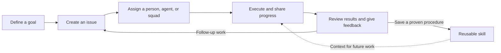
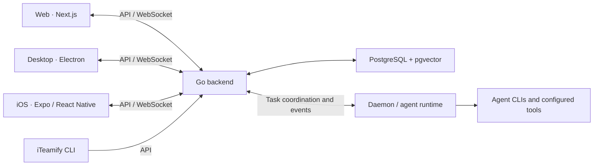

<div align="center">

# iTeamify

**An AI Native collaboration system for humans and agents.**

Turn shared goals into coordinated work.<br/>
Bring people, AI agents, and teams together to plan, execute, and deliver.

[Get Started](#getting-started) · [Capabilities](#capabilities) · [Self-Hosting](#self-hosting) · [Contributing](#contributing)

**English | [简体中文](README.zh-CN.md)**

</div>

---

## What is iTeamify?

**iTeamify is a shared workspace where people and AI agents work toward the same goals.** It brings projects, issues, conversations, agent execution, and reusable skills into one collaboration system.

Give work to a person, an agent, or a squad. Keep the brief, discussion, progress, and results attached to the work. Connect the runtimes and tools your team uses, and turn proven ways of working into skills that others can reuse.

Our vision is to make human–AI collaboration a natural part of how teams operate: people set direction and judge outcomes; agents take on defined responsibilities and carry work forward; the workspace keeps everyone informed.

iTeamify is built for individuals and small teams growing into a hybrid workforce, with web and desktop applications, an iOS client, and a self-hostable backend.

## Why AI Native?

As more work moves to agents, teams need a shared way to answer: **Who owns this? What context do they need? What is happening? What counts as done?**

iTeamify builds those questions into the workflow:

- **Agents have an identity and a role.** They have profiles, can own issues, participate in discussions, and update work through the tools available to them.
- **People and agents share the work.** Projects, assignments, statuses, comments, and notifications provide a common place to coordinate.
- **Context stays close to execution.** Issue briefs, conversations, workspace instructions, skills, and project configuration give agents the background they need.
- **Execution is visible.** Task states, streamed progress, execution logs, and activity history help the team understand what happened and respond to blockers.
- **People guide the outcome.** Define scope and acceptance criteria, review results, give feedback, and decide what should happen next.
- **Good practices become reusable.** Capture repeatable procedures as skills and use autopilots for recurring work.

The goal is a team that can coordinate its combined human and AI capabilities, from the first brief to the final review.

## From goal to outcome



An issue is the shared record of the work. Agent runs are attached to it, so a team can follow both the outcome and the execution behind it. Reviews and skill creation are deliberate team actions in this workflow.

For example, a product team can create an issue for a bug, assign it to a development agent, inspect its progress and proposed fix, ask for changes in the discussion, and save the release procedure as a skill for the next task.

## Capabilities

| Capability | How it helps your team |
| --- | --- |
| **Projects and issues** | Organize work with statuses, priorities, assignees, sub-issues, labels, and board, list, table, or timeline views. |
| **Agents as teammates** | Give agents named profiles, instructions, skills, and a runtime; assign work and follow their activity alongside human members. |
| **Squads** | Group people and agents under a leader agent. Assign work to the squad and let its leader coordinate delegation and follow-up. |
| **Conversations and collaboration** | Discuss work in issue comments, mention collaborators, keep persistent agent conversations, and exchange direct messages with teammates. |
| **Task execution** | Queue and run agent tasks, stream progress, inspect execution history, and interrupt runs when the work needs to change. |
| **Reusable skills** | Share instructions and procedures for reviews, deployments, research, and other repeatable work across the workspace. |
| **Autopilots** | Create and route work through schedules, webhooks, or manual triggers for recurring reports, reviews, and maintenance. |
| **Runtime management** | Connect local daemons and remote runtimes, discover available agent CLIs, and manage custom runtime profiles. |
| **Workspaces and access** | Organize members, agents, projects, and settings within workspace boundaries, with invitations and role-based access. |
| **Web, desktop, and mobile** | Use the web application, an Electron desktop client, or the iOS client to stay connected to your team's work. |

### Work with your choice of agents

iTeamify connects to agent runtimes such as **Claude Code**, **Codex**, **CodeBuddy**, **GitHub Copilot CLI**, **OpenCode**, **OpenClaw**, **Hermes**, **Pi**, **Cursor Agent**, **Kimi**, **Kiro CLI**, **Antigravity**, **Qoder CLI**, and **Trae CLI**.

Custom runtime profiles let you register a team-specific command that uses a supported protocol family. See [Custom Runtimes](docs/custom-runtimes.md) for configuration and command syntax.

An **agent** is the teammate you assign work to. A **runtime** is the environment that executes that work. A **daemon** connects a machine to the backend and runs tasks using its configured agent tools. Available models, tools, and execution behavior depend on the runtime and provider you configure.

## Where iTeamify fits

| Team workflow | Example |
| --- | --- |
| **Software delivery** | Coordinate implementation, testing, code review, and release work across people and agents. |
| **Research and planning** | Assign investigation and drafting tasks, keep findings with the issue, and have people review the conclusions. |
| **Team operations** | Turn recurring summaries, triage, and maintenance into autopilots with visible work records. |
| **Multi-agent collaboration** | Create specialized agents, organize them into squads, and keep their assignments and progress in one workspace. |

These workflows use the same collaboration primitives. What an agent can execute depends on the instructions, tools, credentials, and permissions configured for it.

## Getting started

### 1. Start the workspace from source

For the local server workflow, use macOS, Linux, or WSL2 on Windows.

**Prerequisites:** Node.js 22.13+, pnpm 12.10.1, Go 1.26.1+, and Docker with the Compose plugin for the default local PostgreSQL setup. The required versions are defined in [package.json](package.json) and [server/go.mod](server/go.mod).

```bash
git clone https://github.com/insight68/iTeamify.git
cd iTeamify
npm install --global pnpm@12.10.1
make dev
```

`make dev` prepares the environment file, installs frontend dependencies when needed, sets up the database, applies migrations, and starts the backend and web application.

Open the frontend URL printed in the terminal, normally `http://localhost:3000`, and create your workspace. Configuration options are documented in [.env.example](.env.example).

### 2. Connect an agent runtime

Install and authenticate an agent CLI, such as Claude Code or Codex, on the machine that will execute the work. Then, in a second terminal at the repository root, build the iTeamify CLI and connect it to your local instance:

```bash
(cd server && go build -o bin/iteamify ./cmd/iteamify)

./server/bin/iteamify setup self-host --profile local \
  --server-url http://localhost:8080 \
  --app-url http://localhost:3000
```

This configures the connection, opens browser authentication, and starts the daemon. If your server uses different ports or URLs, use the values printed by your server startup command. The `local` profile keeps this CLI connection separate from other environments.

### 3. Give your agent its first assignment

1. Open the workspace's runtime page and confirm that your machine and its available runtime are connected.
2. Create an agent, choose its runtime, and define its role and instructions.
3. Create an issue with a clear brief and acceptance criteria, assign it to the agent, and move it to **Todo** when it is ready to run.
4. Follow the run, read the results, and use comments to provide feedback or request follow-up work.

You can add skills, squads, and autopilots as your team's workflow develops.

## Self-hosting

The backend and web application can run on your own infrastructure. From a checkout, build and start the Docker Compose stack:

```bash
make selfhost-build
```

This creates `.env` if needed and builds the backend and frontend from the current source. The default endpoints are `http://localhost:3000` for the web app and `http://localhost:8080` for the backend.

Connect execution machines with `setup self-host`, using your deployment's backend and frontend URLs. Deployment settings, including authentication, storage, and public URLs, are listed in [.env.example](.env.example); service definitions live in [docker-compose.selfhost.yml](docker-compose.selfhost.yml).

## CLI

The `iteamify` CLI handles authentication, workspace selection, issue operations, and daemon management. The examples below assume the binary is on your `PATH`; when using the source build above, replace `iteamify` with `./server/bin/iteamify`.

| Command | Purpose |
| --- | --- |
| `iteamify setup self-host --profile local` | Configure a self-hosted connection, authenticate, and start the daemon. |
| `iteamify --profile local workspace list` | List accessible workspaces. |
| `iteamify --profile local workspace switch <id\|slug>` | Select the default workspace for this profile. |
| `iteamify --profile local issue list` | List issues in the selected workspace. |
| `iteamify --profile local issue create` | Create an issue. |
| `iteamify --profile local daemon status` | Check the local daemon. |
| `iteamify --profile local daemon start` | Start the daemon. |

Use `iteamify --help` or `iteamify <command> --help` for the full command reference. Keep `--profile local` when working with the connection created in the quick start.

## Architecture



The backend owns workspace data and task coordination. Execution runtimes perform agent work, while clients receive progress and updates through the API and WebSocket connection.

```text
apps/
  web/          Next.js web application
  desktop/      Electron desktop application
  mobile/       Expo / React Native iOS application
packages/
  core/         API client, queries, shared types, and client state
  ui/           Shared UI primitives
  views/        Shared web and desktop business views
  tsconfig/     Shared TypeScript configuration
server/         Go API, CLI, daemon, and database migrations
```

Web and desktop share business logic and views. Mobile owns its interface and platform behavior and shares types and pure functions where appropriate. The backend uses Chi, sqlc, and gorilla/websocket; frontend server state uses TanStack Query, and client state uses Zustand.

## Contributing

Help build a better way for people and agents to work together. Contributions can include bug reports, documentation, collaboration workflows, runtime integrations, and code.

Read [CLAUDE.md](CLAUDE.md) and [AGENTS.md](AGENTS.md) for architecture and repository conventions. Common development commands:

```bash
make dev              # Prepare and start the local app
pnpm dev:desktop      # Start the desktop app in development
pnpm typecheck        # Check TypeScript
pnpm test             # Run TypeScript tests
make test             # Run Go tests
make check            # Run the full local verification pipeline
```

Use `make help`, [Makefile](Makefile), and [package.json](package.json) for the complete command list. See the [desktop build guide](apps/desktop/README.md) and [iOS development guide](apps/mobile/README.md) for platform-specific workflows.

## License

iTeamify uses a modified Apache License 2.0 with additional commercial-use and branding conditions. See [LICENSE](LICENSE) for the complete terms.
