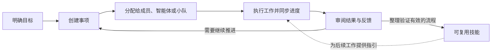
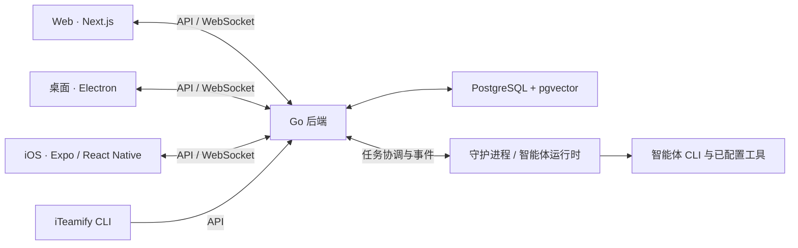

<div align="center">

# iTeamify

**面向人类与智能体的 AI Native 协作系统。**

让共同的目标，成为协同完成的成果。<br/>
将团队成员、AI 智能体和小队连接起来，一起规划、执行与交付。

[快速上手](#快速上手) · [核心能力](#核心能力) · [自部署](#自部署) · [参与贡献](#参与贡献)

**[English](README.md) | 简体中文**

</div>

---

## iTeamify 是什么？

**iTeamify 是一个让人类与 AI 智能体围绕共同目标开展工作的协作空间。** 它将项目、事项、对话、智能体执行和可复用技能组织在同一套协作系统中。

你可以把工作分配给一位成员、一个智能体，或一支小队。需求、讨论、进度和结果始终与工作关联；团队可以接入自己的运行时与工具，并把验证有效的工作方法整理为可复用技能。

我们的愿景是，让人机协作成为团队日常工作的自然方式：人类确定方向、判断结果；智能体承担明确的职责、持续推进工作；协作空间让每位参与者了解工作的进展。

iTeamify 面向个人和小团队，支持逐步建立由人类与 AI 共同组成的团队，提供 Web、桌面和 iOS 客户端，以及可自部署的后端。

## 为什么是 AI Native？

当越来越多的工作交给智能体，团队需要共同回答几个问题：**谁负责？需要哪些背景？现在进展如何？怎样才算完成？**

iTeamify 将这些问题融入协作流程：

- **智能体有身份，也有职责。** 它们拥有档案，可以负责事项、参与讨论，并通过可用工具更新工作。
- **人类与智能体围绕同一份工作协作。** 项目、分工、状态、评论和通知，让所有参与者在同一个空间中协调。
- **上下文与执行相连。** 事项说明、对话、工作区指引、技能和项目配置，为智能体提供完成工作所需的背景。
- **执行过程可以追踪。** 任务状态、实时进度、执行日志和活动历史，帮助团队理解发生了什么、及时处理阻塞。
- **人类把握方向和结果。** 明确范围与验收标准，审阅产出、给出反馈，并决定下一步行动。
- **有效的方法可以复用。** 将重复使用的流程整理为技能，把周期性工作交给自动化。

我们希望团队能够组织好人类与 AI 的共同能力，让协作贯穿需求提出、任务执行与结果验收。

## 从目标到成果



事项（Issue）是团队共同维护的工作记录，智能体的执行任务与事项关联，便于追踪结果和产生结果的过程。图中的审阅与技能沉淀，由团队根据实际工作主动完成。

例如，产品团队可以为一个缺陷创建事项，分配给开发智能体，查看执行进度与修复方案，在讨论中提出修改要求，再将验证有效的发布流程整理为技能，供后续任务使用。

## 核心能力

| 能力 | 为团队带来的价值 |
| --- | --- |
| **项目与事项管理** | 通过状态、优先级、负责人、子事项和标签组织工作，使用看板、列表、表格或时间线查看进展。 |
| **智能体即队友** | 为智能体设置名称、职责、指引、技能和运行时；与人类成员一起参与分工，持续了解它们的工作动态。 |
| **小队（Squads）** | 将成员与智能体组成由负责人智能体带领的小队，把工作交给小队，由负责人协调分工与跟进。 |
| **对话与协作** | 在事项评论中讨论工作、提及协作者，保留与智能体的持续对话，也可以与团队成员直接沟通。 |
| **任务执行** | 管理智能体任务的排队与执行，实时查看进度、检查执行历史，并在需要调整工作时中断运行。 |
| **可复用技能（Skills）** | 将审查、部署、研究等工作的指引与流程整理为技能，在工作区内共享与复用。 |
| **自动化（Autopilots）** | 通过定时、Webhook 或手动触发创建并分配工作，用于周期性报告、审查与维护。 |
| **运行时管理** | 连接本地守护进程与远程运行时，发现可用的智能体 CLI，管理自定义运行时配置。 |
| **工作区与访问管理** | 按工作区组织成员、智能体、项目和设置，支持邀请与角色权限。 |
| **Web、桌面与移动端** | 通过 Web 应用、Electron 桌面客户端或 iOS 客户端，保持与团队工作的连接。 |

### 使用你选择的智能体

iTeamify 可以连接 **Claude Code**、**Codex**、**CodeBuddy**、**GitHub Copilot CLI**、**OpenCode**、**OpenClaw**、**Hermes**、**Pi**、**Cursor Agent**、**Kimi**、**Kiro CLI**、**Antigravity**、**Qoder CLI** 和 **Trae CLI** 等智能体运行时。

自定义运行时配置允许团队注册使用受支持协议的 CLI 命令。配置方式与命令语法见[自定义运行时指南](docs/custom-runtimes.md)。

**智能体（Agent）**是负责工作的协作者，**运行时（Runtime）**是执行工作的环境，**守护进程（Daemon）**负责将机器连接到后端，并使用已配置的智能体工具执行任务。可用模型、工具与执行行为，取决于你配置的运行时和服务提供方。

## 适用场景

| 团队工作 | 示例 |
| --- | --- |
| **软件交付** | 在成员与智能体之间协调开发、测试、代码审查和发布任务。 |
| **研究与规划** | 分配调研和起草工作，将发现保留在事项中，由人类审阅结论。 |
| **团队日常运营** | 用自动化安排周期性总结、事项分流和维护，保留可追踪的工作记录。 |
| **多智能体协作** | 创建承担不同职责的智能体，将它们组织为小队，在同一工作区查看分工与进展。 |

这些场景使用同一套协作能力。智能体实际能够执行哪些操作，取决于为它配置的指引、工具、凭据和权限。

## 快速上手

### 1. 从源码启动协作空间

本地服务开发流程适用于 macOS、Linux，以及 Windows 上的 WSL2。

**环境要求：** Node.js 22.13+、pnpm 12.10.1、Go 1.26.1+；默认本地 PostgreSQL 环境需要 Docker 及 Compose 插件。版本要求以 [package.json](package.json) 和 [server/go.mod](server/go.mod) 为准。

```bash
git clone https://github.com/insight68/iTeamify.git
cd iTeamify
pnpm install --global pnpm@12.10.1
make dev
```

`make dev` 会准备环境文件、按需安装前端依赖、配置数据库、执行迁移，并启动后端与 Web 应用。

打开终端输出的前端地址，默认是 `http://localhost:3000`，并创建工作区。配置项说明见 [.env.example](.env.example)。

### 2. 连接智能体运行时

在执行工作的机器上安装并完成智能体 CLI 的认证，例如 Claude Code 或 Codex。然后在仓库根目录打开另一个终端，编译 iTeamify CLI，连接本地服务：

```bash
(cd server && go build -o bin/iteamify ./cmd/iteamify)

./server/bin/iteamify setup self-host --profile local \
  --server-url http://localhost:8080 \
  --app-url http://localhost:3000
```

这条命令会配置连接、打开浏览器完成认证，并启动守护进程。如果使用了其他端口或地址，请填入服务启动时输出的实际值。`local` 配置档案将这套 CLI 连接与其他环境隔离。

### 3. 分配第一个任务

1. 打开工作区的运行时页面，确认机器及其可用运行时已连接。
2. 创建智能体，选择运行时，并说明它的职责与工作指引。
3. 创建事项，写清需求与验收标准，分配给智能体；准备执行时，将状态设为**待办（Todo）**。
4. 查看执行过程和结果，通过评论补充反馈或提出后续工作。

随着协作方式逐步成熟，你可以继续加入技能、小队和自动化。

## 自部署

你可以在自己的基础设施上运行后端与 Web 应用。在源码目录中构建并启动 Docker Compose 服务：

```bash
make selfhost-build
```

该命令会在需要时创建 `.env`，并从当前源码构建后端和前端。默认 Web 地址为 `http://localhost:3000`，后端地址为 `http://localhost:8080`。

执行机器通过 `setup self-host` 连接，使用部署环境的后端与前端地址。认证、存储和公开访问地址等部署配置见 [.env.example](.env.example)，服务定义见 [docker-compose.selfhost.yml](docker-compose.selfhost.yml)。

## CLI

`iteamify` CLI 提供认证、工作区选择、事项操作和守护进程管理。以下示例假定命令已加入 `PATH`；如果使用前面的源码构建，将 `iteamify` 替换为 `./server/bin/iteamify`。

| 命令 | 用途 |
| --- | --- |
| `iteamify setup self-host --profile local` | 配置自部署连接、完成认证并启动守护进程。 |
| `iteamify --profile local workspace list` | 列出可访问的工作区。 |
| `iteamify --profile local workspace switch <id\|slug>` | 为当前配置档案选择默认工作区。 |
| `iteamify --profile local issue list` | 列出当前工作区的事项。 |
| `iteamify --profile local issue create` | 创建事项。 |
| `iteamify --profile local daemon status` | 检查本地守护进程状态。 |
| `iteamify --profile local daemon start` | 启动守护进程。 |

完整命令与参数说明可通过 `iteamify --help` 或 `iteamify <command> --help` 查看。使用上手流程创建的连接时，请保留 `--profile local`。

## 架构



后端管理工作区数据与任务协调，运行时执行智能体工作，客户端通过 API 和 WebSocket 获取进度与更新。

```text
apps/
  web/          Next.js Web 应用
  desktop/      Electron 桌面应用
  mobile/       Expo / React Native iOS 应用
packages/
  core/         API 客户端、查询、共享类型与客户端状态
  ui/           共享基础 UI 组件
  views/        Web 与桌面共享的业务视图
  tsconfig/     共享 TypeScript 配置
server/         Go API、CLI、守护进程与数据库迁移
```

Web 与桌面共享业务逻辑和视图。移动端独立维护界面与平台行为，按需共享类型和纯函数。后端使用 Chi、sqlc 和 gorilla/websocket；前端服务端状态由 TanStack Query 管理，客户端状态由 Zustand 管理。

## 参与贡献

一起建设更好的人类与 AI 协作方式。你可以提交问题、改进文档、分享协作流程、接入运行时，或贡献代码。

开发前请阅读 [CLAUDE.md](CLAUDE.md) 和 [AGENTS.md](AGENTS.md)，了解架构与仓库规范。常用命令：

```bash
make dev              # 准备并启动本地应用
pnpm dev:desktop      # 启动桌面开发环境
pnpm typecheck        # TypeScript 类型检查
pnpm test             # TypeScript 测试
make test             # Go 测试
make check            # 完整本地验证流程
```

完整命令以 `make help`、[Makefile](Makefile) 和 [package.json](package.json) 为准。平台开发流程见[桌面构建指南](apps/desktop/README.md)和 [iOS 开发指南](apps/mobile/README.md)。

## 许可证

iTeamify 使用附加商业使用与品牌条款的修改版 Apache License 2.0。完整条款请阅读 [LICENSE](LICENSE)。
