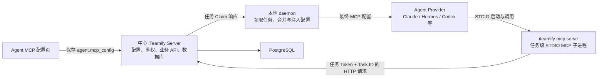
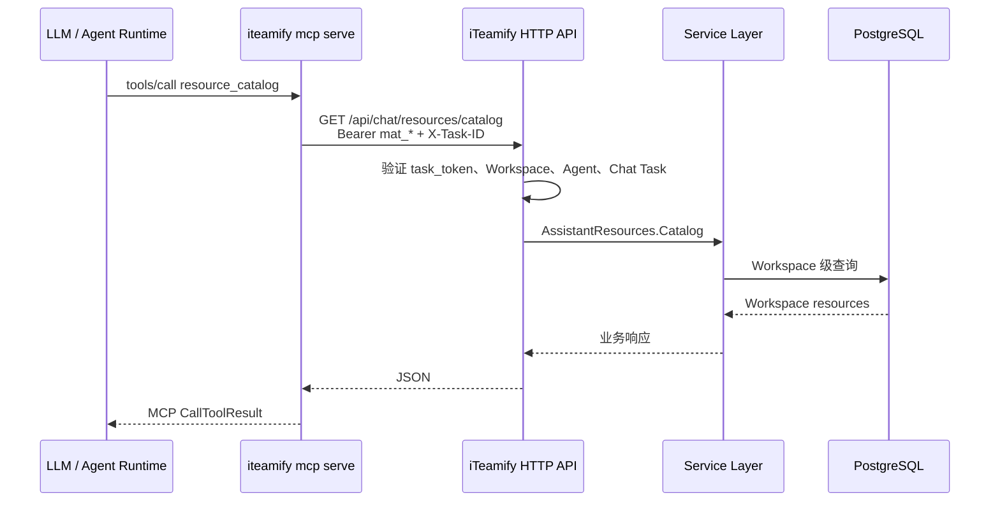

# iTeamify MCP Server 架构

> 文档状态：当前实现说明
>
> 最后核对：2026-08-09
>
> 适用范围：Agent 的 `mcp_config`、Runtime 本地 MCP、内置 `iteamify` MCP Server、Provider 适配及任务级鉴权

## 1. 结论

iTeamify 的 MCP 架构不是“把 MCP Server 放在中心 Server”或“把 MCP Server 写进 daemon”二选一，而是由三部分协作：

- **中心 iTeamify Server** 保存 Agent 配置，签发任务身份，并提供 企业资料、事项和通用资源等业务 API。
- **Runtime 机器上的 daemon** 领取任务，合并 MCP 配置，注入任务级身份，并把最终配置交给 Agent Provider。
- **`iteamify mcp serve` 子进程** 在 Runtime 机器上通过 STDIO 提供 MCP 协议，再使用任务 Token 调用中心 Server 的 HTTP API。

MCP 工具定义的源码位于 [`server/internal/mcpserver/server.go`](../server/internal/mcpserver/server.go)，进程入口位于 [`server/cmd/iteamify/cmd_mcp.go`](../server/cmd/iteamify/cmd_mcp.go)。虽然源码都在仓库的 `server/` Go 工程中，但这个 MCP Server 不是中心 HTTP Server 内部的长驻服务；它是在任务执行机器上启动的独立进程。

## 2. 组件与职责



| 组件 | 运行位置 | 主要职责 | 不负责的事情 |
| --- | --- | --- | --- |
| MCP 配置页 | Web/Desktop | 编辑当前 Agent 可使用的 MCP Server 配置 | 不编写、不托管 MCP Server 源码 |
| 中心 Server | 服务端 | 保存配置、任务调度、鉴权、业务校验、事务、审计、事件和数据库访问 | 不充当当前内置 MCP 的 STDIO 进程 |
| daemon | Runtime 机器 | 获取任务身份、合并配置、注入保留的 `iteamify` Server、准备 Provider 执行环境 | 不直接实现事项等业务规则 |
| Agent Provider | Runtime 机器 | 将配置交给 Claude、Hermes、Codex、Cursor 等运行时，并管理 MCP 客户端连接 | 不持久化 iTeamify 业务数据 |
| `iteamify mcp serve` | Runtime 机器 | 将 iTeamify HTTP API 包装成 MCP Tools | 不绕过中心 Server 直接访问数据库 |

## 3. 为什么配置注入必须在 daemon

当前内置 MCP 使用 STDIO。它必须作为 Agent Provider 可访问的本地子进程运行，因此配置和进程启动需要发生在 Runtime 机器，而不是中心 Server。

daemon 负责注入的原因包括：

1. **靠近 Agent Runtime**：STDIO MCP 需要与 Claude、Hermes、Codex 等 Provider 建立本机进程管道。
2. **任务级身份**：`ITEAMIFY_TOKEN`、`ITEAMIFY_TASK_ID`、`ITEAMIFY_AGENT_ID` 等值只有领取具体任务后才能确定，不能静态写入 Agent 配置。
3. **版本一致性**：daemon 解析当前 iTeamify 可执行文件的绝对路径，确保注入的 `iteamify mcp serve` 与运行中的 daemon 来自同一套二进制。
4. **本地配置与秘密不外传**：daemon 可以读取 Runtime 机器已有的 MCP 配置，在本地完成合并；公开能力接口只返回脱敏摘要。
5. **任务生命周期隔离**：MCP 进程属于 Agent 任务进程树，任务取消或结束时可随 Provider 一起退出。

daemon 并不是把 MCP Server 作为内部 goroutine 运行。它注入以下配置，实际子进程通常由 Agent Provider 间接启动：

```json
{
  "mcpServers": {
    "iteamify": {
      "command": "/absolute/path/to/iteamify",
      "args": ["mcp", "serve"]
    }
  }
}
```

注入逻辑位于 [`server/internal/daemon/runtime_mcp.go`](../server/internal/daemon/runtime_mcp.go)，任务启动前的调用点位于 [`server/internal/daemon/daemon.go`](../server/internal/daemon/daemon.go)。

## 4. 端到端执行流程

### 4.1 保存 Agent 配置

Agent 页面路由的 `view=mcp_config` 展示的是“这个 Agent 可以使用的 MCP Server”，不是 MCP Server 代码编辑器。

页面对单个 Server 进行编辑，然后自动保存为统一结构：

```json
{
  "mcpServers": {
    "company-data": {
      "command": "/opt/homebrew/bin/node",
      "args": ["/absolute/path/company-mcp/dist/index.js"],
      "env": {
        "API_TOKEN": "replace-me"
      }
    },
    "crm": {
      "type": "http",
      "url": "https://mcp.example.com/mcp",
      "headers": {
        "Authorization": "Bearer replace-me"
      }
    }
  }
}
```

相关前端实现：

- [`packages/views/agents/components/tabs/mcp-config-tab.tsx`](../packages/views/agents/components/tabs/mcp-config-tab.tsx)：新增、更新和删除 Server。
- [`packages/views/agents/components/tabs/mcp-server-dialog.tsx`](../packages/views/agents/components/tabs/mcp-server-dialog.tsx)：表单和单 Server JSON 编辑器。
- [`packages/views/agents/components/tabs/mcp-config-model.ts`](../packages/views/agents/components/tabs/mcp-config-model.ts)：规范化 `mcpServers`，兼容 OpenCode 原生顶层 `mcp`。

中心 Server 将原始 JSON 保存到 `agent.mcp_config`。Agent Actor 永远不能读取其中的秘密；其他调用者也会根据权限和工作区策略得到原值或 `mcp_config_redacted=true` 的脱敏响应。读写和脱敏逻辑位于 [`server/internal/handler/agent.go`](../server/internal/handler/agent.go)，SQL 位于 [`server/pkg/db/queries/agent.sql`](../server/pkg/db/queries/agent.sql)。

### 4.2 中心 Server 生成任务 Claim 数据

任务被领取时，中心 Server 读取最新的 Agent 配置。若任务有临时的 `runtime_mcp_overlay`，先按 Server 名将它覆盖到 `agent.mcp_config` 上。

当前 Overlay 主要用于把 Composio 等用户会话级 MCP 地址绑定到单次任务。它不会永久写回 Agent 配置，任务结束后会被清理。

实现位置：

- [`server/internal/handler/mcp_overlay.go`](../server/internal/handler/mcp_overlay.go)：Overlay 合并规则。
- [`server/internal/handler/daemon.go`](../server/internal/handler/daemon.go)：构造 daemon Claim 响应。

### 4.3 daemon 生成最终 MCP 配置

daemon 收到任务后执行以下步骤：

1. 解析任务级 `mat_` Token。
2. 读取任务携带的 `agent.mcp_config`，其中可能已包含任务 Overlay。
3. 对支持本地发现的 Provider，读取 Runtime 机器已有的 MCP 配置。
4. 以 Server 名为键合并；Agent/任务配置覆盖 Runtime 本地同名配置。
5. 使用保留名称 `iteamify` 注入内置 Server，并覆盖任何同名用户配置。
6. 将结果交给 Provider 适配器。

最终优先级从高到低为：

```text
保留的 iteamify Server
    > 任务 runtime_mcp_overlay
    > Agent mcp_config
    > Runtime 本地 MCP 配置
```

`iteamify` 必须保留给系统。用户在 Agent 页面中添加同名 Server 不会覆盖内置命令。

### 4.4 Provider 物化配置

统一的 `mcpServers` 文档会被转换为不同 Provider 的原生形态：

| Provider | 物化方式 | 主要实现 |
| --- | --- | --- |
| Claude | 写入权限为 `0600` 的临时 `mcp-config.json`，通过 `--mcp-config` 加载；管理配置存在时使用严格配置语义 | [`server/pkg/agent/claude.go`](../server/pkg/agent/claude.go) |
| CodeBuddy | 写入临时配置，通过 `--mcp-config` 加载 | [`server/pkg/agent/codebuddy.go`](../server/pkg/agent/codebuddy.go) |
| Qwen | 写入临时配置，通过 `--mcp-config` 加载 | [`server/pkg/agent/qwen.go`](../server/pkg/agent/qwen.go) |
| Codex | 转换为任务级 `$CODEX_HOME/config.toml` 中受 daemon 管理的 `[mcp_servers.*]` 区块 | [`server/pkg/agent/codex.go`](../server/pkg/agent/codex.go) |
| Cursor | 在任务执行环境生成 Cursor 原生项目配置和审批 Sidecar | [`server/internal/daemon/execenv/cursor_mcp.go`](../server/internal/daemon/execenv/cursor_mcp.go) |
| OpenCode | 转换为原生 `mcp` 结构，通过 `OPENCODE_CONFIG_CONTENT` 注入 | [`server/pkg/agent/opencode_mcp.go`](../server/pkg/agent/opencode_mcp.go) |
| OpenClaw | 写入任务级 Wrapper 配置的 `mcp.servers` | [`server/internal/daemon/execenv/openclaw_config.go`](../server/internal/daemon/execenv/openclaw_config.go) |
| Hermes、Kimi、Kiro、Qoder、Trae CLI、Grok | 转换为 ACP `session/new` / `session/load` 的 `mcpServers` 数组 | [`server/pkg/agent/hermes.go`](../server/pkg/agent/hermes.go) |
| OpenAgent | 解析成 SDK 的 `MCPServers` Map，在 SDK 初始化阶段连接 | [`server/pkg/agent/openagent.go`](../server/pkg/agent/openagent.go) |

Provider 是否支持 Agent MCP 配置由前端 [`packages/core/agents/mcp-support.ts`](../packages/core/agents/mcp-support.ts) 控制；内置 `iteamify` MCP 的 daemon 支持列表由 `providerSupportsFirstPartyMCP` 控制。新增 Provider 时必须同时核对 UI 可见性、daemon 注入和 Provider 物化三处能力。

当前代码中，OpenAgent 后端可以消费 `McpConfig`，daemon 也会注入内置 `iteamify` Server，但前端支持列表尚未包含 `openagent`，因此其 Agent MCP 配置页不会显示。这是三个支持列表之间需要显式处理的现状；若要开放 OpenAgent 的用户管理配置，必须同步补齐前端列表和测试。

### 4.5 Provider 启动 MCP 子进程

Provider 读取最终配置后，在任务进程树中启动：

```bash
/absolute/path/to/iteamify mcp serve
```

入口会创建官方 Go MCP SDK 的 Server，并使用 `mcp.StdioTransport` 运行。它要求当前环境中同时存在 `ITEAMIFY_AGENT_ID` 和 `ITEAMIFY_TASK_ID`，否则拒绝启动。

对于大多数 Provider，MCP 子进程继承 Agent 任务的 `ITEAMIFY_*` 环境变量。Hermes 会过滤 STDIO MCP 子进程环境，因此 daemon 会把所需任务变量显式写入 Hermes 的 ACP MCP 配置，但这些值只存在于任务内存和子进程环境中。

### 4.6 MCP Tool 调用中心业务 API

内置 MCP Server 只做协议适配和轻量参数校验，所有业务操作仍经过中心 Server：



该边界保证 MCP 不能绕过中心 Server 的授权、校验、事务、幂等、审计和事件机制。MCP 客户端请求头的设置位于 [`server/internal/cli/client.go`](../server/internal/cli/client.go)。

## 5. 配置来源与本地发现

### 5.1 Agent 管理配置

Agent 管理配置保存在中心数据库，适合团队统一管理的 STDIO、HTTP 和 SSE MCP Server。配置中的 `env` 和 `headers` 可能包含秘密，因此不能把它理解为“只在本机保存”。

### 5.2 Runtime 本地配置

daemon 当前可从以下位置读取完整的 Runtime 本地配置，并只在 Runtime 机器内参与合并：

| Provider | 本地来源 |
| --- | --- |
| Claude / CodeBuddy | `~/.claude.json`，以及已启用 Claude Plugin 的 MCP 清单 |
| Codex | `$CODEX_HOME/config.toml`，未设置时为 `~/.codex/config.toml` |
| Cursor | `~/.cursor/mcp.json` |
| OpenCode | `$XDG_CONFIG_HOME/opencode/opencode.json`，未设置时为 `~/.config/opencode/opencode.json` |
| OpenClaw | `$CLAWDBOT_CONFIG_PATH`，或 `$OPENCLAW_STATE_DIR/openclaw.json`，再回退到 `~/.openclaw/openclaw.json` |

完整条目可能带有命令、参数、URL、Header 和环境变量，不能上传到中心 Server 或写入日志。能力页面使用独立的脱敏摘要，只包含名称、Transport、来源和启用状态。两类读取逻辑都位于 [`server/internal/daemon/runtime_mcp.go`](../server/internal/daemon/runtime_mcp.go)。

## 6. 配置格式

### 6.1 STDIO

```json
{
  "command": "/opt/homebrew/bin/node",
  "args": ["/absolute/path/company-mcp/dist/index.js"],
  "env": {
    "API_BASE_URL": "https://api.example.com",
    "API_TOKEN": "replace-me"
  }
}
```

约束：

- `command` 是可执行文件，不是 Shell 字符串。
- 不支持在 `command` 中使用 `cd`、管道、重定向、`&&` 或 Shell 展开；复杂启动逻辑应使用可执行 Wrapper。
- 推荐使用绝对路径，且文件必须存在于执行该 Agent 的 Runtime 机器。
- MCP 协议写入 `stdout`，普通日志必须写入 `stderr`。

### 6.2 Streamable HTTP

```json
{
  "type": "http",
  "url": "https://mcp.example.com/mcp",
  "headers": {
    "Authorization": "Bearer replace-me"
  }
}
```

### 6.3 SSE

```json
{
  "type": "sse",
  "url": "https://mcp.example.com/sse",
  "headers": {
    "Authorization": "Bearer replace-me"
  }
}
```

当前表单模式只直接表达 STDIO 和 HTTP。SSE 应使用单 Server JSON 模式编辑，避免表单保存时把类型规范化为 HTTP。

### 6.4 OpenClaw 远程 Transport

OpenClaw 的 STDIO 字段与统一格式一致，但 HTTP/SSE 使用原生 `transport` 字段：

```json
{
  "transport": "streamable-http",
  "url": "https://mcp.example.com/mcp",
  "headers": {
    "Authorization": "Bearer replace-me"
  }
}
```

### 6.5 Server 名称

管理页面接受 ASCII 字母、数字、下划线和连字符，例如 `company-data`。这个限制也满足 Codex TOML Bare Key 的要求。

`iteamify` 是保留名称，不能用于自定义 Server。

跨 Provider 的 `enabled` / `disabled` 字段目前没有统一的执行语义。需要停用一个 Agent 管理的 MCP Server 时，删除该条目是最可预测的操作。

## 7. 内置 `iteamify` MCP Server

`mcpserver.New` 当前注册以下白名单工具：

- 公开网络检索：`web_search`、`web_fetch`
- 企业上下文与资料：`company_context_get`、`company_profile_get`、`company_profile_update`
- 通用业务资源：`resource_catalog`、`resource_describe`、`resource_query`、`resource_get`、`resource_action_preview`、`resource_action_execute`

工具库存测试位于 [`server/internal/mcpserver/server_test.go`](../server/internal/mcpserver/server_test.go)，用于防止无意暴露新的高权限工具。当前实现不提供任意 SQL Tool。

### 7.1 工具命名

MCP Server 注册的规范工具名是 `resource_catalog`。不同 Provider 可能改变展示名称：

- 常见 Provider：`resource_catalog`
- Hermes：`mcp_iteamify_resource_catalog`

Hermes 名称可理解为：

```text
mcp_ + Server 名 iteamify + Tool 名 resource_catalog
```

因此，`mcp_iteamify_resource_catalog` 不是一个要添加到 Agent 配置页的 Server，也不是独立的 MCP 配置项；它是 Hermes 对内置工具的运行时命名。

## 8. 鉴权与秘密边界

### 8.1 任务级环境

daemon 为当前任务准备：

```text
ITEAMIFY_TOKEN=mat_...
ITEAMIFY_SERVER_URL=...
ITEAMIFY_WORKSPACE_ID=...
ITEAMIFY_AGENT_ID=...
ITEAMIFY_TASK_ID=...
ITEAMIFY_TASK_SLOT=...
```

`iteamify mcp serve` 使用这些值创建 HTTP API Client，并发送：

```text
Authorization: Bearer mat_...
X-Workspace-ID: ...
X-Agent-ID: ...
X-Task-ID: ...
```

Server 端还会验证认证中间件标记的 Actor 来源必须是 `task_token`，不能仅凭客户端自行填写 `X-Task-ID` 获得任务权限。

### 8.2 秘密存储边界

- Agent `mcp_config`：存储在中心数据库，读接口按权限脱敏。
- 任务 `runtime_mcp_overlay`：中心 Server 在调度时生成，仅用于单次任务并在结束后清理。
- Runtime 本地 MCP 完整配置：只在 daemon 所在机器读取和合并，不能通过能力接口返回。
- `iteamify` 任务 Token：不写入 Agent 长期配置；由 daemon 在任务执行时提供。
- Hermes 显式环境：只发送任务所需的 `ITEAMIFY_*` 值，不回退到 daemon 自身的长期凭证。

### 8.3 信任边界

内置 MCP Server 是一个受信任的协议桥，但并不是业务授权边界。业务授权始终由中心 Server 完成。新增内置 Tool 时，应继续调用现有 Handler/Service/API，不应在 MCP 进程里建立数据库连接或复制授权逻辑。

## 9. 失败模式与可观测性

| 失败点 | 当前行为 | 排查位置 |
| --- | --- | --- |
| daemon 无法解析自身绝对路径 | 记录警告，继续执行但不自动注入内置 MCP | `first-party server executable unavailable` |
| 内置 MCP 注入失败 | 记录警告，保留已有配置继续执行 | `first-party server injection failed` |
| Runtime 本地配置读取/解析失败 | 记录警告并回退到 Agent 配置 | `runtime merge failed` |
| Provider 配置转换失败 | 多数 Provider 启动失败并返回明确错误；ACP 单条无效 Server 可能被跳过并记录警告 | 对应 `server/pkg/agent/*` 日志 |
| `iteamify mcp serve` 缺少 Agent/Task 身份 | MCP 子进程拒绝启动 | `mcp serve is only available inside a iTeamify agent task` |
| 任务 Token 或 Chat 归属无效 | 中心 Server 返回 `403` 或业务错误 | Server 请求日志和 Lead/Quote Handler |
| MCP 进程向 `stdout` 打印普通日志 | 破坏 STDIO MCP 协议 | MCP 子进程 `stderr` 与 Provider MCP 日志 |

当 `mcp_iteamify_resource_catalog` 没有出现在 Hermes 工具列表时，应先检查 daemon 注入日志和 MCP 子进程启动日志，而不是在 Agent 页面手工添加 `iteamify`。

## 10. 扩展内置 MCP 的方法

新增 iTeamify 内置 Tool 时：

1. 在 [`server/internal/mcpserver/server.go`](../server/internal/mcpserver/server.go) 定义输入结构并调用 `mcp.AddTool`。
2. 将业务操作委托给中心 Server 已有的 HTTP API；如果 API 不存在，先在 Handler 和 Service 层建立正确的权限与事务边界。
3. 在 [`server/internal/mcpserver/server_test.go`](../server/internal/mcpserver/server_test.go) 更新工具白名单，并增加参数、API 路径和错误场景测试。
4. 如果工具有操作规范，同步更新 `server/internal/service/builtin_skills/` 下相应的内置 Skill 和 Source Map。
5. 不要通过修改 `runtime_mcp.go` 添加业务 Tool；该文件只负责发现、合并和注入 MCP 配置。

典型注册结构：

```go
type SearchInput struct {
	Query string `json:"query" jsonschema:"要搜索的内容"`
}

mcp.AddTool(server, &mcp.Tool{
	Name:        "knowledge_search",
	Description: "搜索企业知识库",
}, func(
	ctx context.Context,
	_ *mcp.CallToolRequest,
	input SearchInput,
) (*mcp.CallToolResult, any, error) {
	var output any
	if err := client.GetJSON(ctx, "/api/chat/knowledge?query="+url.QueryEscape(input.Query), &output); err != nil {
		return nil, nil, fmt.Errorf("search knowledge: %w", err)
	}
	return &mcp.CallToolResult{}, output, nil
})
```

Go 代码注释必须使用英文；上例中的 `jsonschema` 是向模型展示的 Tool 输入说明，可以根据产品面向的模型语言选择合适文本。

## 11. 测试与变更检查清单

架构相关测试主要分布在：

- [`server/internal/daemon/runtime_mcp_test.go`](../server/internal/daemon/runtime_mcp_test.go)：Runtime 本地发现、优先级、保留名称和 Hermes 环境。
- [`server/internal/mcpserver/server_test.go`](../server/internal/mcpserver/server_test.go)：内置工具库存与 HTTP API 映射。
- [`server/pkg/agent/codex_test.go`](../server/pkg/agent/codex_test.go)：Codex TOML 物化和隔离。
- [`server/pkg/agent/opencode_mcp_test.go`](../server/pkg/agent/opencode_mcp_test.go)：OpenCode 格式转换。
- [`server/internal/daemon/execenv/cursor_mcp_test.go`](../server/internal/daemon/execenv/cursor_mcp_test.go)：Cursor Sidecar。
- [`server/internal/daemon/execenv/openclaw_config_test.go`](../server/internal/daemon/execenv/openclaw_config_test.go)：OpenClaw 配置。
- [`packages/core/agents/mcp-support.test.ts`](../packages/core/agents/mcp-support.test.ts)：前端 Provider 支持列表。
- [`packages/views/agents/components/tabs/mcp-config-tab.test.tsx`](../packages/views/agents/components/tabs/mcp-config-tab.test.tsx)：管理页面保存和删除行为。

修改 MCP 架构时至少检查：

- Provider 是否同时接收 Agent 管理配置和内置 `iteamify` Server。
- Runtime 本地配置是否会因管理配置或内置注入而意外丢失。
- 同名覆盖优先级是否保持 `iteamify > Overlay > Agent > Runtime`。
- 秘密是否可能进入日志、公开能力接口、命令行参数或权限过宽的 Agent API 响应。
- 临时文件是否使用 `0600`，任务结束后是否清理。
- 取消任务时 Provider、MCP Server 和工具子进程是否一起退出。
- 新 Tool 是否仍通过中心 Service 层执行鉴权、事务、审计和事件。

## 12. 当前设计边界

- 当前内置 MCP 是任务级 STDIO 桥接，不是公开的中心 Streamable HTTP MCP Endpoint。
- Agent 页面只保存连接或启动配置，不上传本地 MCP 源码和构建产物。
- Runtime 本地完整配置的自动发现目前只覆盖 Claude/CodeBuddy、Codex、Cursor、OpenCode 和 OpenClaw。
- 不同 Provider 对扩展字段、禁用字段、OAuth 和远程 Transport 的支持并不完全一致；统一 UI 结构必须经过 Provider 适配器转换。
- 内置 Lead、Quote、Company 等工具受 Chat Task 约束。工具出现在列表中不代表任意任务都拥有调用权限，中心 Server 仍会逐次验证。
