# Assistant Resource Architecture

This is the extension contract for product features whose records should be
readable or editable by a workspace assistant through Chat. The assistant is
given domain resources and named actions; it is never given physical table
names, SQL, or an arbitrary CRUD endpoint.

```mermaid
flowchart LR
    Page["Product page"] -->|select resource| Context["Chat resource context"]
    Context --> Claim["Task claim + prompt"]
    Claim --> MCP["Generic resource MCP tools"]
    MCP --> Registry["Assistant Resource Registry"]
    Registry --> Policy["Task principal + role/action policy"]
    Policy --> Preview["Preview + confirmation + version check"]
    Preview --> Service["Existing domain service"]
    Service --> Audit["assistant_operation audit + idempotency"]
    Audit --> Event["resource:changed"]
```

## Runtime contract

- The server resolves workspace, task, agent, human originator, and current
  member role from the task token; actions additionally require a validated
  Chat session. MCP input cannot override any of them.
- `resource_catalog` and `resource_describe` expose only the resources and
  actions allowed for that role.
- Reads go through `resource_query` and `resource_get` with declared filters
  and page-size limits.
- Writes are named domain actions. They run through the same service used by
  normal product APIs, preserving validation and domain events.
- `resource_action_preview` is read-only. A confirmed action also requires the
  ID of a real user message in the current task input, a fresh idempotency key,
  and an expected version when the action declares optimistic concurrency.
- Every execution is recorded in `assistant_operation`; a successful identical
  retry returns the stored result. Reusing the key with another payload fails.
- A successful action emits the generic `resource:changed` event. Existing
  domain-specific events remain authoritative where they already exist.

## Adding a resource to a new feature

1. Keep domain validation and transactions in a service under
   `server/internal/service`. Do not put business rules in an MCP handler.
2. Add an adapter in
   `server/internal/handler/assistant_resource_adapters.go` with:
   - a stable singular resource name;
   - field and filter metadata;
   - read roles;
   - named actions, action roles, risk, confirmation policy, input schema,
     resource-ID requirement, and expected-version requirement;
   - bounded `Query`/`Get` methods and `Preview`/`Execute` delegation.
3. Register the adapter in `newAssistantResourceRegistry`.
4. For page-to-Chat handoff, call
   `setPendingContextResources([{ resource_type, resource_id, ... }])` before
   opening a new Chat. The next session creation validates and stores these
   records atomically. Existing sessions use the context-resource API/hooks.
5. Add an invalidation branch for `resource:changed` only when the domain does
   not already emit a more specific event; avoid duplicate invalidations.
6. Add registry policy tests, adapter tests, prompt/context tests, and MCP tool
   inventory tests.

## HTTP and persistence

Agent/task-scoped endpoints:

- `GET /api/resources/catalog`
- `GET /api/resources/{resource}`
- `POST /api/resources/query`
- `GET /api/resources/{resource}/{resourceId}`
- `POST /api/resources/actions/preview`
- `POST /api/resources/actions/execute`

Human session-context endpoints:

- `GET /api/chat/sessions/{sessionId}/resources`
- `PUT /api/chat/sessions/{sessionId}/resources`
- `DELETE /api/chat/sessions/{sessionId}/resources/{contextId}`

The `assistant_operation` and `chat_context_resource` tables intentionally use
soft relationships, following the repository's no-foreign-key rule. Chat
deletion removes context rows explicitly in the same application transaction.

## Initial registrations

| Resource | Read | Assistant actions |
| --- | --- | --- |
| `lead` | query/get | `create`, `update`, `add_note` |
| `opportunity` | query/get | `enrich` for evidenced empty descriptive fields; confirmed `update` for overrides, clears and business decisions |
| `company_profile` | singleton query/get | `update` for owner/admin |

The company page and lead-management table are the first product-page handoff
examples. New modules should reuse this contract rather than add another
feature-specific assistant gateway.
