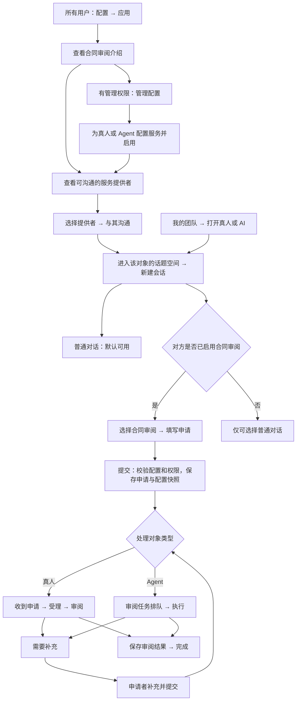

# PRD：会话应用配置

日期：2026-10-12

状态：已按用户授权完成一期实现与本地验收，尚未部署。真人流程已通过双方浏览器验收；AI 自动派发与业务动作通过测试任务验证，真实模型读取合同和生成结果尚未验收。

## 1. 需求与核心决策

普通对话是默认应用。用户能够与某位真人或 Agent 沟通时，就能够向该对象发起普通对话。

合同审阅是所有用户都能打开的业务应用。用户可以查看应用介绍以及自己有权沟通的服务提供者；只有为指定真人或 Agent 完成配置并启用后，才能在与该对象沟通时新建合同审阅 session。

应用入口设在左侧导航的“配置”分组，名称为“应用”，对工作区内所有用户可见。用户从“我的团队”选择沟通对象，或从应用页点击某位提供者的“与其沟通”进入该对象的话题空间，再新建对应 session。

**打开应用、拥有应用、发起应用 session 是三件事。**打开应用不要求本人拥有该应用，也不创建 session；拥有应用表示自己能作为该业务的处理方；发起 session 则要求对方已配置并启用该应用。

本方案明确：**应用提供什么服务，由系统定义；谁提供服务及如何处理，由对象的应用配置决定；某次申请使用哪个配置，由 session 在提交时记录。**

### 1.1 已确定的实施决策

| 项目 | 方案 | 确定程度 |
| --- | --- | --- |
| 普通对话 | 所有可沟通对象默认具备，不能关闭 | 用户已明确 |
| 合同审阅 | 仅配置并启用的对象提供 | 用户已明确 |
| 打开应用 | 工作区所有用户可打开应用页面，未配置对象时仍可查看介绍 | 用户已明确 |
| 创建业务 session | 在与已启用该应用的真人或 AI 沟通时创建；申请者本人无须拥有应用 | 用户已明确 |
| 配置入口 | 左侧“配置 → 应用” | 用户已明确 |
| 一期配置人 | 工作区 owner/admin 统一配置，真人与 Agent 拥有者可查看自己的服务配置 | 用户授权后已实施 |
| 应用复用 | 同一内置应用可配置给多个真人、多个 Agent；各自独立配置 | 用户授权后已实施 |
| Agent 开始处理 | 点击“提交审阅”后自动创建审阅任务；打开页面不触发执行 | 用户授权后已实施 |

一期采用管理员统一配置。应用拥有权表示可作为处理方提供服务，配置管理权仍由工作区 owner/admin 角色决定。

## 2. 实施前的状态与问题

本节记录制定方案时核对的源码状态；下述缺口已在本期补齐。生产部署未在本次范围内。

- `ContainerPicker` 固定列出普通对话、合同审阅，未按对象的应用配置过滤。
- 真人页仅检查对方仍是成员；Agent 页检查 Agent 可调用权限，没有“该对象是否提供合同审阅”的判断。
- 合同创建服务已验证成员、Agent 权限、文件和字段，但没有对象级应用绑定。
- 现有 session 已持久保存容器类型，合同申请有独立记录、状态、附件、处理动作及讨论。
- Agent 合同提交目前不创建任务，需要打开讨论再发指令，服务提交与实际处理之间缺少直接衔接。
- 当前配置导航包含技能、Agent、销售专家、连接、用量和设置，没有会话应用入口。
- 现有 Agent 业务动作的用户意图凭证以当前任务输入中的用户消息为依据。结构化提交自动执行需要增加真实提交来源，不能仅调用聊天排队函数便视为完成接入。

这次重点补齐服务提供关系和配置生命周期，复用已有合同业务与容器。

## 3. 目标与范围

1. 所有用户都能打开应用页面；作为处理对象，普通成员默认只提供普通对话，配置了合同审阅的法务同时提供两种应用。
2. 真人与 Agent 使用同一套应用配置、应用发现、提交与历史恢复规则。
3. 配置发布后，新建会话能立即反映；服务端对提交再次校验。
4. 用户提交后能够明确知道申请已交给谁、当前处于什么状态、下一步谁负责。
5. 应用配置调整、暂停不会改变已经提交申请的内容、处理规则和历史。
6. 所有应用访问继续遵守工作区、参与者及 Agent 调用权限。

一期交付“应用配置模块 + 按对象展示应用 + 合同真人流程 + 合同 Agent 提交执行闭环”。普通对话保持现有收发方式。

## 4. 产品模型

| 概念 | 含义 | 示例 |
| --- | --- | --- |
| 应用定义 | 系统提供的业务种类、界面、字段与流程能力 | 普通对话、合同审阅 |
| 处理对象 | 实际接收和处理申请的人或 Agent | 法务王明、合同审阅 Agent |
| 应用配置 | 某对象在当前工作区提供该应用的规则与状态 | 王明的合同范围、申请要求、启用状态 |
| Session | 用户与对象围绕一件事建立的持久身份 | A 公司采购合同申请 |
| 业务记录 | 一次申请的资料、状态、结果和处理历史 | 某份合同审阅申请 |

规则：

- 配置属于“工作区 + 处理对象 + 应用”。同一真人在不同工作区的配置独立。
- 一期每个对象对同一应用只有一份配置；多人可以提供相同应用。
- 普通对话是系统默认项，不要求给所有成员逐一创建配置记录。
- 所有用户可以打开合同审阅应用页面；即使没有任何对象配置它，应用介绍仍可查看，服务提供者列表显示暂无可用对象。
- 申请者不需要拥有合同审阅应用。对方拥有并启用该应用，才决定双方话题空间能否新建合同 session。
- 某成员给自己配置合同审阅，表示他向别人提供审阅服务；不会使他与所有其他成员的菜单都出现合同审阅。
- 用户先选择处理对象，再选择该对象的应用。一次申请有一位固定处理对象，一期不在提交后自动换人或换 Agent。
- 一个 session 有一个主应用，提交后保持身份稳定。合同内的“讨论”是该申请的沟通视图。
- 底层 `kind=direct/agent` 仍表示沟通关系；容器类型负责加载应用界面，不能用 `kind=form` 替代。

### 4.1 示例

| 用户打开的对象 | 对象配置 | 新建会话可选项 |
| --- | --- | --- |
| 销售李华 | 未配置业务应用 | 普通对话 |
| 法务王明 | 合同审阅已启用，当前用户可与其沟通 | 普通对话、合同审阅 |
| 通用助手 | 未配置合同审阅 | 普通对话 |
| 合同审阅 Agent | 合同审阅已启用且用户可调用该 Agent | 普通对话、合同审阅 |
| 法务王明 | 合同审阅暂停 | 普通对话；已有合同 session 仍可打开 |
| 私有 Agent | 当前用户无调用权限 | 保持既有 Agent 访问限制，应用配置不增加访问权 |

## 5. 整体业务流程

补充仍进入原处理对象的分支，不改变处理对象。

### 5.1 配置方：发布一项服务

1. 打开“配置 → 应用”，查看系统提供的应用。
2. 打开合同审阅，进入“管理配置”，点击“新增配置”。
3. 选择工作区中的一位真人或一个 Agent。列表排除已离开成员、已归档 Agent，以及已存在该应用配置的对象。
4. 填写服务介绍、提交要求和处理规则。一期面向所有有权与该对象沟通的成员，不额外配置应用使用名单。
5. 真人配置确认接收人；Agent 配置显示其运行环境、应用所需业务工具和处理指令。
6. 保存草稿，或在配置验证通过后启用。草稿不出现在用户的新建会话选项中。
7. 启用后，该对象的菜单向符合权限的成员展示合同审阅。真人接收者可查看自己提供服务的说明。
8. 修改已启用配置时点击“保存并生效”，生成新配置版本，仅影响之后提交的新申请。

配置管理员拥有配置管理权，不因此获得成员私信、合同和文件的查看权。私有 Agent 的测试同样要求测试者具有调用权限。

### 5.2 用户：向真人提交合同

1. 从“我的团队”打开法务王明。
2. 点击“新建会话”，看到普通对话及王明已启用的合同审阅。
3. 选择合同审阅，看到“由王明处理”、服务说明、可处理合同范围和提交要求。
4. 填写标题、合同类型、优先级、期望完成日期、商机阶段、业务背景及重点事项，上传合同资料。标题和合同文件必填，背景和重点事项由服务配置决定是否必填；其他字段沿用内置表单规则。此时仅为草稿，不产生对方可见申请。
5. 点击“提交审阅”。服务端重新检查应用启用状态、配置版本、使用权限和表单规则。
6. 保存成功后生成唯一 session 和申请，进入详情，显示“已提交，等待王明受理”。王明收到私密未读通知。
7. 王明受理、开始审阅；需要材料时选择“要求补充”并填写具体要求。
8. 申请者收到“待补充”，按本申请原配置补充材料并重新提交，仍进入王明的处理流程。
9. 王明提交审阅结果并完成。申请者查看结果；讨论和资料始终对应同一申请。

真人不会因为启用应用而被自动替换为 Agent，系统也不会自动转交其他法务。

### 5.3 用户：向 Agent 提交合同

1. 从“我的团队”打开已提供合同审阅的 Agent，选择该应用并填写表单。
2. 提交按钮显示“提交审阅”；附近明确说明“提交后由该 Agent 自动处理”。
3. 提交成功同时持久保存申请和可恢复的任务派发记录，自动进入既有任务队列。
4. Agent 在线且有处理容量时开始执行；离线或繁忙时显示排队状态，恢复后执行。未配置运行环境，或运行环境缺少私密合同文件读取能力的 Agent 不能启用该应用。当前 MCP-only 平台托管运行环境尚无文件读取工具，因此暂不可启用；支持现有 `iteamify contract-file download` 的已注册运行环境可以启用。
5. Agent 读取本申请的合同资料、审查要求与冻结的配置，通过业务动作进入审阅流程并保存结果。
6. 需要补充时，业务状态变为“待补充”，本轮任务结束等待用户。用户通过“提交补充”动作发起下一轮审阅，不需要再打一遍聊天指令。
7. 任务失败时保留申请和输入，显示失败原因及“重试处理”。同一申请不并行启动重复审阅任务。
8. 只有审阅结果已保存且完成动作成功，业务状态才显示“已完成”。模型输出或任务结束本身不等同于完成申请。

单纯打开表单、切换 session、刷新或查看讨论均不创建审阅任务。讨论消息按现有通信机制处理，不重复派发结构化提交的审阅任务。

## 6. 配置模块页面

### 6.1 导航和权限

- 在现有配置分组的 Agent 入口后新增“应用”，保持其他导航不变。
- 建议工作区路径 `/{workspaceSlug}/applications`。
- 所有工作区用户都能看到入口，打开应用列表、介绍和自己有权沟通的已启用服务提供者。
- owner/admin 另外看到全部应用配置和管理动作。
- 普通成员可以查看自己作为处理对象的配置；查看其他提供者时仅返回公开服务说明，不显示内部处理指令或管理动作。
- 应用页的“与其沟通”跳转到对应真人或 Agent 的话题空间，不直接创建 session；用户在该对象的新建会话入口选择应用。
- 一期不另设应用使用白名单；服务使用继续受原有成员、沟通及 Agent 调用权限约束。打开应用不会放宽私有 Agent 访问权。

#### 为真人或 AI 开通应用的具体入口

入口为：**左侧配置 → 应用 → 合同审阅 → 管理配置 → 新增配置**。

配置人选择“处理对象：真人王明 / 某个 Agent”，填写该对象的服务要求，再点击“启用”。这一步给指定对象开通合同审阅的服务资格；申请者无需另外开通。后续在同一列表编辑或暂停这份配置。

“拥有应用”的关系由对象与应用的配置绑定表达，“能否接收新申请”由启用状态表达，不在成员角色设置中另加一个重复的应用权限开关。保存草稿尚未开通；暂停后保留配置及历史，但不接收新的合同 session。

按已实施的一期方案，只有工作区 owner/admin 可执行新增、编辑、启用和暂停；普通用户可以打开应用、查看自己的配置和使用已启用的服务。这项配置管理权与“自己是否拥有合同审阅应用”独立，拥有应用不自动获得给他人开通应用的权限。

例：管理员给法务王明启用合同审阅后，销售李华无需拥有该应用，也可在与王明沟通时新建合同审阅 session；与尚未开通的成员沟通时仍只有普通对话。

### 6.2 应用列表

| 应用 | 所有用户可查看 | 有配置管理权时额外显示 |
| --- | --- | --- |
| 普通对话 | 系统默认、所有可沟通对象具备、应用说明 | 不能关闭或删除 |
| 合同审阅 | 应用介绍、公开服务说明、当前用户可用的服务提供者 | 查看对象配置、新增配置 |

一期列出系统内置的两种应用，不按当前用户是否拥有应用隐藏列表项。应用页使用“介绍”“服务提供者”，为相应角色增加“我的配置”“管理配置”。

服务提供者列表只列出当前用户可沟通且已启用应用的对象，包含姓名、真人/AI 标识、服务说明和“与其沟通”。没有可用对象时显示“暂无可用服务提供者”，不显示创建申请表单；管理员同时可看到“新增配置”。

### 6.3 合同审阅的对象配置列表

一行对应一份对象配置，展示处理对象及真人/AI 标识、服务名称、服务说明、草稿/已启用/已暂停、最近修改人和时间。

该列表属于“管理配置”，支持按对象搜索、按状态筛选。管理员可编辑、启用、暂停、删除草稿；普通成员的“我的配置”仅显示自己的记录。它与全员可查看的“服务提供者”列表分开，均不展示合同标题、申请人数明细或文件。

### 6.4 配置表单

| 分组 | 字段 | 一期规则 |
| --- | --- | --- |
| 处理对象 | 真人或 Agent | 必选；发布后不能直接更换，另建对象配置 |
| 服务展示 | 服务名称、提交说明 | 名称默认“合同审阅”；说明面向申请者公开 |
| 服务对象 | 所有有沟通权限的成员 | 一期固定规则，不配置额外应用使用名单 |
| 合同范围 | 允许的合同类型 | 可不限制；设置后表单与后端按范围校验 |
| 提交要求 | 业务背景必填、重点事项必填 | 在内置字段上调整；标题与合同文件始终必填 |
| 默认项 | 默认优先级 | 普通/高/紧急；申请者可按需求选择 |
| 审查规则 | 审查重点、结果要求 | 真人可查看；Agent 执行时必须带入当前申请的规则快照 |
| Agent 专属 | 处理指令、依赖能力检查 | 使用所选 Agent 的既有运行环境和模型，不在此复制 Agent 设置 |

初建可以“保存草稿”或“启用”；编辑已发布配置使用“保存并生效”。保存失败保留输入，不能显示为启用成功。

标题和文件要求、工作区隔离、参与者权限、最大上传限制属于系统规则，不能通过配置放宽。一期不提供任意字段编辑器和流程编排器。

## 7. 状态与变更规则

应用状态、业务状态、任务状态分别表达不同事项：

| 层 | 状态 | 影响 |
| --- | --- | --- |
| 应用配置 | 草稿、已启用、已暂停 | 是否接收新申请 |
| 合同申请 | 已提交、已受理、待补充、审阅中、已完成 | 业务处理进度 |
| Agent 任务 | 排队、运行、失败、结束等既有任务状态 | 某轮执行情况 |

### 7.1 配置变更

- 提交时冻结服务名称、配置版本、提交规则和处理规则。
- 新配置只影响新申请。已提交申请和补充材料使用该申请原规则，避免突然要求旧申请重新填写新字段。
- 表单打开后、提交前发生配置变更，提示“提交要求已更新”，刷新要求并保留兼容的字段和选中的文件，由用户确认后重新提交。
- 配置版本变化不能自动增加已有申请的可见人，也不能改变处理对象。

### 7.2 暂停和删除

- 暂停的含义是“不再接收新申请”。菜单移除该业务应用；未提交草稿不能继续提交，但应保留输入。
- 已提交申请继续查看、补充和处理，已有 Agent 任务不因暂停应用被自动取消。
- 提交恰好与暂停并发时，以服务端事务内的状态校验为准。已成功提交的幂等重试应返回原申请，不能因为之后暂停而伪装成提交失败。
- 从暂停恢复后重新接收新申请。
- 从未被申请引用的草稿可删除。已有申请引用的配置保留身份，只能暂停；不通过“删除应用”清除业务数据。
- 成员离开、Agent 归档或调用权限撤回后，新申请不可创建，历史查看和操作受当前业务权限约束，不能由配置快照绕过撤权。
- 不在本模块自动转交未完成申请。处理对象不可用时明确显示状态及原因。
- 应用暂停与运行环境卸载是不同操作。当前运行环境硬删除链可能清理关联合同；实施时必须处理此边界，不能用删除配置暗中触发清理。优先阻止破坏仍需保留的关联申请，保留历史的具体实现需在编码前确认。

## 8. 功能要求

- **FR-01**：普通对话是所有可沟通对象的默认应用，无需配置，不可关闭。
- **FR-02**：增加对所有工作区用户可见的“应用”入口。应用介绍与公开服务提供者信息全员可打开，配置管理动作另行验证管理权。
- **FR-03**：同一工作区、同一对象、同一应用不能重复配置；另一工作区独立。
- **FR-04**：与某对象新建合同 session 时，只检查该处理对象是否已启用合同审阅及当前用户的原有沟通权限，不要求申请者自己拥有该应用。对象可用指真人仍在工作区，或 Agent 未归档且具有已配置的运行环境；Agent 暂时离线可以接收排队申请，页面必须告知用户。
- **FR-05**：新建菜单从服务端读取当前对象的可用应用，缺少配置时只有普通对话。仅有普通对话时点击新建直接进入对话；存在业务应用时弹出应用选择。
- **FR-06**：无法加载业务应用列表时，显示加载失败和重试；普通对话仍按已有沟通权限可用，不能推测合同应用已启用。
- **FR-07**：业务草稿以工作区、当前用户、处理对象、配置和新 session 身份隔离。
- **FR-08**：直接 URL、旧客户端和手工 API 请求都不能绕过应用配置与权限校验。未提交的新建页若应用不可用，应明确提示并保留草稿；已有申请不能因为应用暂停而被新建页的校验挡住。
- **FR-09**：创建申请在提交事务内验证配置状态、版本及规则，保存配置快照和唯一申请身份。
- **FR-10**：真人申请通知只发送给实际参与者，管理员配置权不授予申请查看权。
- **FR-11**：Agent 提交与补充自动派发对应审阅任务，任务失败不丢失申请，支持明确的重试入口。
- **FR-12**：Agent 授权证据来自本次真实结构化提交或补充动作，绑定申请、提交者和版本；不伪造用户聊天消息，也不移除现有动作授权要求。
- **FR-13**：申请、可恢复的派发意图及任务身份具有事务和幂等保障；重复点击、丢回执、服务重启不会重复申请或派发同一轮任务。
- **FR-14**：对已提交请求的重试先安全恢复原结果；对新请求才校验当前接收状态。相同幂等身份异内容必须拒绝。
- **FR-15**：应用配置变更实时刷新对应对象的菜单和草稿提交要求，不能用缓存作为最终权限依据。
- **FR-16**：暂停只影响新申请，既有申请按冻结规则继续办理，同时持续尊重当前成员和 Agent 权限。
- **FR-17**：历史 session 根据服务端保存的主应用与业务记录恢复，不按对象当前配置猜测。
- **FR-18**：配置列表仅呈现服务配置，不扩展成管理员可浏览的私密申请列表。
- **FR-19**：未知应用类型显示明确只读提示；客户端不支持业务容器时保留既有升级提示机制。旧创建请求缺少新协议所需配置身份或版本时提示升级，不能按默认规则绕过服务要求；已有申请的读取按其已保存元数据处理。
- **FR-20**：有申请引用的应用配置不可硬删除，工作区/会话主动删除仍走明确的既有业务清理操作。
- **FR-21**：打开应用页、查看服务提供者及跳转“与其沟通”不创建新 session 或任务；业务 session 在处理对象的话题空间中，由明确的新建和提交动作建立。

## 9. 用户故事与验收

以下一期流程已使用 Playwright 浏览器、独立数据库和相关单元测试验收。Web 与 Desktop 复用页面并通过类型检查；原生 Electron 操作及真实 AI 模型尚未验收。

### US-001：配置指定对象的合同服务

作为管理员，我希望给法务和合同 Agent 配置服务，使用户只向真实提供该服务的对象发起申请。

- [x] “配置 → 应用”可进入管理页；普通对话标记系统默认且不可关闭。
- [x] 可选当前工作区真人或 Agent，保存草稿、验证并启用；不能重复配置。
- [x] 内置字段要求和处理规则可保存；配置失败保留输入。
- [x] 普通成员不能调用管理 API，管理员也不能借配置权查看私密合同。
- [x] Typecheck/lint 通过；共享页面通过 Web 浏览器及窄屏布局验收，Desktop 路由通过类型检查。

### US-002：按处理对象选择应用

作为申请者，我希望新建会话时看到该对象能处理的业务。

- [x] 未配置对象只有普通对话；启用合同应用的对象显示两项。
- [x] 所有用户可打开应用页；未拥有合同应用的申请者，可以向已配置的法务或 Agent 发起合同 session。
- [x] 应用页无服务提供者时仍可查看介绍；点击“与其沟通”只导航，未提交时不创建业务记录。
- [x] 自己具备合同应用不会改变与其他对象的菜单。
- [x] 暂停应用或撤回原有沟通权限后，菜单更新；伪造 URL/API 无法提交。
- [x] 应用列表加载失败提供重试；不错误展示合同表单。
- [x] 草稿与已提交申请分别恢复，切换对象、session 和工作区不串数据。
- [x] Typecheck/lint 通过；浏览器验收真人和 Agent 两种对象。

### US-003：办理真人合同申请

作为申请者与法务，我希望申请明确送到指定法务，并按服务要求完成。

- [x] 提交前显示处理者、说明和要求；提交后生成唯一申请并通知对方。
- [x] 法务能受理、要求补充、审阅并保存结果；申请者只能执行自己的合法动作。
- [x] 修改服务要求后，旧申请仍使用原规则补充，新申请采用新规则。
- [x] 业务未读和讨论未读独立；第三方不可读取申请、文件或私密事件。
- [x] 相关后端测试与 Typecheck/lint 通过；浏览器以双方身份走完完整流程。

### US-004：Agent 自动处理结构化申请

作为申请者，我希望提交合同后 Agent 开始办理，不需要再次发送启动指令。

- [x] 打开页面不会产生任务；提交成功和补充成功各派发唯一一轮任务。
- [x] 排队/运行/失败状态可见，失败后可重试，正在运行时不能重复派发。
- [x] Agent 仅读取当前申请，带入冻结的处理规则与真实提交授权证据。
- [x] 文件下载、受理、开始审阅、要求补充、保存结果与完成动作均受业务权限和版本约束。
- [x] 任务结束但结果未保存时，申请不能显示已完成。
- [x] 测试任务验证真实提交凭证、文件权限、规则快照与结果写入。
- [ ] 真实 Agent 读取合同及模型生成审阅结果的端到端验收尚未执行。
- [x] Typecheck/lint、相关后端检查通过；浏览器验收执行状态、补充与失败恢复。

### US-005：调整服务而不破坏既有申请

作为管理员，我希望暂停或更新服务，同时保留已经发生的业务。

- [x] 暂停后不能新提交，已提交申请仍可按权限继续；恢复后可新建。
- [x] 幂等重试可恢复暂停前成功的提交结果，不能生成第二份申请。
- [x] 服务改名、改要求不覆盖旧申请快照；已有引用的配置不可硬删除。
- [x] 无配置关联的既有合同 session 保留历史和原处理行为，不反推为该对象已启用应用。
- [x] 成员退出、Agent 撤权和运行环境清理边界有明确测试，不以应用配置扩大权限或丢失记录。
- [x] Typecheck/lint、相关后端检查通过；浏览器验收配置变更和历史恢复。

## 10. 技术落点与迁移要求

以下是支持产品流程的技术建议，命名和 API 需在实施时与当前规范核对。

- 内置应用定义维护稳定类型、名称、支持的对象种类、配置 schema 和业务适配器；一期可以由服务端代码定义，不新增应用市场数据库。
- 增加工作区内“应用与处理对象绑定”记录：ID、工作区、应用类型、对象种类与 ID、状态、配置 JSON、版本、修改人和时间。配置 JSON 必须按应用专属 schema 校验。
- Session 记录业务应用绑定身份与版本；合同申请保存处理配置快照。普通对话无须绑定记录。
- 业务应用发现接口建议 `GET /api/session-applications?target_kind=member|agent&target_id=...`。响应只返回当前用户有权使用的公开应用描述和提交要求，不返回内部处理指令。
- 应用目录/介绍、公开服务提供者、配置管理和申请创建接口分别执行访问规则：所有工作区成员可读应用目录，服务提供者按当前沟通权限过滤，管理接口验证管理权，创建接口验证对方的服务与业务权。不能复用仅管理员可调用的配置 API 作为全员应用页的数据来源。配置并发修改携带版本，过期更新返回冲突。
- React Query 持有应用定义、绑定、可用应用和业务记录；可用应用 query key 包含工作区、当前用户与对象身份。Zustand 仅持有草稿和视图。
- Web/Desktop 复用 `packages/core` 与 `packages/views`，两个平台均接入新路由和导航。原生 Mobile UI 不包含在一期；后端仍必须对旧客户端执行一致的服务权限校验。
- 应用事件只携带必要配置身份与状态，不携带私密申请内容；订阅后刷新对应 query。
- Agent 自动提交执行复用任务生命周期，但需扩展任务输入和业务动作意图验证，支持可信的结构化提交来源。任务派发与业务提交必须可恢复，不能只在 HTTP 返回后调用一次不可恢复的排队操作。
- 已有普通对话无需回填对象配置。已有合同申请保留历史和原规则，绑定可空并标记既有记录；升级不能自动给所有处理对象启用合同审阅。
- 从新版本上线后，新合同创建必须通过启用配置。原创建入口同样受控，不保留绕过配置的内部路径。
- 不改已应用迁移；新增迁移不加外键或级联，新索引使用独立单语句 `CREATE [UNIQUE] INDEX CONCURRENTLY`。

当前主要接入点：

| 范围 | 文件 |
| --- | --- |
| 配置分组、团队入口 | `packages/views/layout/app-sidebar.tsx`、`team-sidebar-group.tsx` |
| 新建选项和容器加载 | `packages/views/chat/session-containers/container-picker.tsx`、`container-host.tsx` |
| 真人与 Agent 页面 | `packages/views/chat/member-chat-page.tsx`、`chat-page.tsx` |
| 合同表单与处理 | `packages/views/chat/session-containers/contract-review-container.tsx` |
| 合同 API 与领域服务 | `server/internal/handler/contract_review.go`、`server/internal/service/contract_review.go` |
| Agent 调用和业务授权 | `packages/core/permissions/rules.ts`、`server/internal/handler/assistant_resource.go`、`assistant_resource_contract_review.go` |
| 任务队列 | `server/internal/service/task.go` |
| 路由与平台 | `packages/core/paths/paths.ts`、Web 工作区路由、Desktop `routes.tsx` |

## 11. 一期非目标

- 任意自定义应用代码、远程插件、iframe 加载、应用市场。
- 任意表单设计器、流程引擎、多级审批。
- 一个人为同一应用提供多个套餐、收费、计费规则和自动 SLA 承诺。
- 申请自动派单、真人与 Agent 混合处理、转交或多人共同处理。
- 修改 Agent 的模型、连接、通用技能管理方式；应用只引用现有 Agent 能力。
- 自动合同签署、对外发送审阅结果、生成完整修订版合同。

## 12. 成功标准

| 场景 | 可验收结果 |
| --- | --- |
| 新工作区、没有配置 | 所有人可打开合同应用介绍，暂无服务提供者；可沟通对象均能普通对话，不能新建合同 session |
| 申请者未拥有合同应用 | 可打开应用，并在与已启用该应用的法务或 Agent 沟通时新建合同 session |
| 只启用法务 A | A 显示合同审阅，成员 B 不显示；Agent 也按各自配置判断 |
| 配置与访问权限不同 | 能管理配置不等于能调用私有 Agent 或查看私密申请 |
| 打开旧表单后暂停 | 新提交被拒绝，字段和文件保留；已成功提交重试恢复原结果 |
| 配置规则改版 | 新申请使用新规则；已有申请继续原规则 |
| 真人申请 | 提交、受理、补充、结果、讨论可完成并私密同步 |
| Agent 申请 | 仅提交/补充/明确重试触发对应任务；结果成功保存后完成 |
| 历史与卸载 | 暂停和配置调整不丢历史；破坏性清理有明确约束 |

指标先采用上述业务验收，不预设没有基线支撑的使用率或效率提升百分比。

## 13. 实施顺序

1. 确认配置权限、同应用多对象复用、Agent 提交启动方式，以及运行环境删除的历史保留边界。
2. 建立对象应用绑定、配置管理与服务端应用发现；普通对话默认规则同时落地。
3. 新建菜单按对象配置展示，合同提交校验配置，记录规则快照。
4. 完成人类合同申请、更新/暂停、旧申请恢复和权限验收。
5. 接入 Agent 的结构化提交来源、可靠派发、状态、补充与重试；完成真实执行验收后才将相关 Agent 应用视为业务可交付。

## 14. 实施结果与边界

1. 工作区 owner/admin 统一管理配置；真人和 Agent 拥有者可查看自己的完整配置，其他成员只见公开服务信息。
2. 一个应用定义可给多个对象分别配置；每个对象每个应用只有一份配置。
3. Agent 提交、补充和明确重试原子创建任务；打开应用不触发任务。
4. 会破坏关联合同历史的运行环境清理返回 409，要求先迁移 Agent。
5. 缺少私密合同文件读取能力的运行环境禁止启用合同服务，普通对话不受此限制。当前 MCP-only 托管运行环境暂不可用。
6. 两组浏览器流程、相关 Go/前端测试、共享包与 Desktop 类型检查、变更文件 lint、Web 生产构建通过；真实模型、原生 Electron、原生 Mobile 与生产部署未验收。
