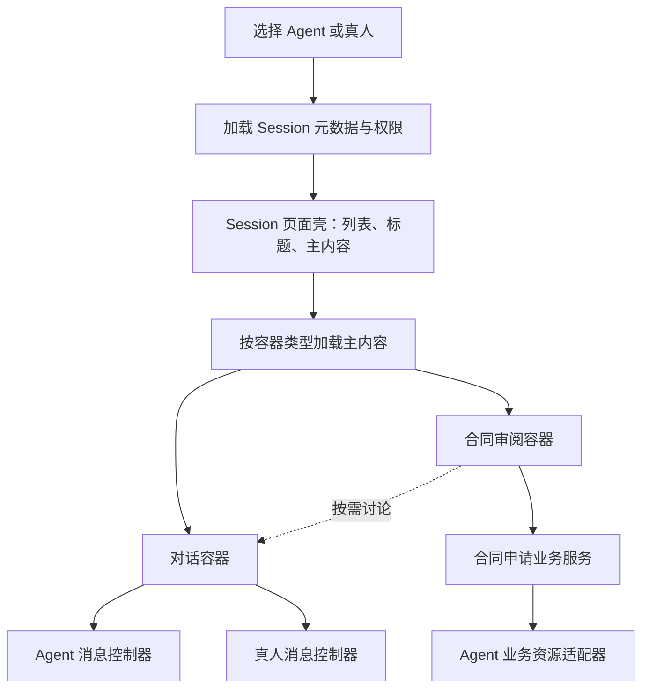

# PRD：按 Session 加载业务容器

日期：2026-10-11

状态：用户已授权实施，普通对话与合同审阅一期已完成本地实现和验收。真实模型、原生 Electron 与生产部署未验收。下文保留原方案；当前实现和验收边界见 `SESSION_CONTAINERS.md`。

## 1. 需求理解

与 Agent 或真人沟通时，同一对象下可以有多个 session，每个 session 根据业务加载相应容器。对话是其中一种容器；需求提交、合同审阅、文档处理等也可以成为 session 的主要界面。

一期按业务界面模块实现容器：每个 session 一个主容器，业务容器按需打开讨论；首个业务场景为合同审阅。

## 2. 实施前核实的基础

- `packages/views/chat/chat-page.tsx:26` 根据 `member` 分流真人私信与 Agent 对话；两者都使用 `session` 选择话题。
- `packages/views/chat/components/chat-shell.tsx:11` 接收列表和主内容，已有可调整双栏布局及窄屏列表/详情切换，可继续复用布局能力。
- `server/migrations/625_chat_participants.up.sql` 已将两类会话存于同一个 `chat_session` 表：`kind=agent` 或 `kind=direct`。`kind` 表达沟通关系。
- `packages/core/types/chat.ts` 与 `packages/core/team/types.ts` 分别定义 Agent 会话、真人会话的响应结构，目前没有容器描述。
- `server/internal/handler/direct_message.go:246` 创建真人 session 与首条文字消息在同一事务提交；该消息必须为 1–20000 字符，并拒绝附件、Agent 上下文和项目上下文。
- `server/internal/handler/chat_context_resource.go` 和 `server/internal/assistantresource/README.md` 已提供 Agent 读取业务记录及执行具名业务动作的机制；当前 session 上下文 API 只接受 Agent 会话。
- `server/internal/handler/file.go:429` 的 session 上传入口调用 Agent 会话权限检查；现有下载检查主要以工作区成员身份为边界，不能直接视为真人私信文件权限。

以上为实施前源码基线，部分接口已由本次实现扩展；未检查生产运行状态。

## 3. 推荐的产品模型

三件事分别确定：

| 概念 | 负责什么 | 示例 |
| --- | --- | --- |
| 沟通对象 | 谁参与、谁能访问、谁能执行动作 | Agent、真人成员 |
| Session | 一件事情的持久身份、标题、活动和关联资料 | 日常咨询、A 公司合同审阅 |
| 容器 | 这件事情的主要工作界面和操作 | 对话、合同需求提交与审阅 |

容器选择属于 session。同一位法务的日常咨询可以使用对话容器，合同申请使用合同审阅容器；支持相应业务的 Agent 也可以使用合同审阅容器。

第一期建议一个 session 有一个主容器。业务容器可按需打开复用的讨论模块。将来需要多个并列容器时，再引入容器实例列表。

创建时选择业务类型；提交后保持主容器类型和业务身份稳定。合同表单提交后显示申请详情、状态与结果，仍属于同一个合同审阅容器。打开“讨论”只切换当前用户的视图，不改变对方看到的主容器类型。

## 4. 用户体验

1. 点击 Agent 或真人，继续打开最近的 session；列表显示 session 类型和业务摘要。
2. 新建时选择“普通对话”或该对象可处理的业务类型。
3. 普通对话沿用现有消息发送、失败重试及 Agent 运行状态。
4. 合同审阅先显示提交表单。候选字段包括合同文件、类型、优先级、期望完成时间、业务背景、重点审查事项和商机阶段；具体字段待确认。
5. 提交成功后，在同一个 session 中显示申请详情、处理进度、补充材料与结果。讨论入口按需打开。
6. 真人侧显示受理、要求补充、提交结果等有权限的动作；Agent 侧显示任务执行与产出状态。参与者不同不要求复制整套业务容器。
7. 切回其他 session 后再次打开，主容器、业务记录与讨论历史仍对应原 session。

候选合同流程：提交 → 受理 → 审阅中 → 完成；“待补充”可进入补充材料分支。实际状态和允许动作由业务服务定义。

## 5. 技术结构



### 5.1 页面与容器

- 沿用 `ChatShell` 的布局能力，逐步将主内容插槽从 `conversation` 调整为通用 `content`。页面壳负责列表、选择、标题和布局。
- 在 `packages/views` 中增加容器宿主和内置注册表。注册表映射稳定类型名、可用会话种类和组件，并支持按需加载。
- 对话容器内部根据 `kind` 使用现有 Agent 或真人控制器。收发、重试、停止任务和读游标继续走各自已实现的路径。
- 非对话容器打开时不挂载完整聊天控制器；页面渲染、切换视图和恢复 session 都不自动触发 Agent 执行。
- 业务容器调用业务 query/mutation，讨论部分复用对话容器组件。
- 一期只支持随版本发布的内置容器；远程代码加载、iframe 插件市场和通用页面搭建器不在一期范围。

### 5.2 Session 元数据

在现有 `chat_session` 上增加最小的容器描述字段，建议为：

- `container_type`：默认 `conversation`，业务示例为 `contract_review`。
- `container_resource_type` / `container_resource_id`：可空，指向业务服务持有的记录。

API 使用同一份容器描述扩展 Agent 与真人响应，示意：

```json
{
  "id": "session-id",
  "kind": "direct",
  "container": {
    "type": "contract_review",
    "resource": {
      "type": "contract_review_request",
      "id": "request-id"
    }
  }
}
```

此 JSON 为结构示意，ID 在实际 API 中使用合法 UUID。

`kind` 继续表达 `agent` / `direct`；不能增加 `kind=form` 来表达容器。合同字段和流程状态保存在独立业务记录里，不塞进消息文本或 session 配置 JSON。Session 的 active/archived 与申请的 submitted/completed 等业务状态分开。

一期无需新的通用容器实例表。需要一个 session 多个有独立身份的容器时，才扩展数据模型。

### 5.3 结构化提交与消息发送

普通对话保留原有创建/发送流程。业务提交走独立的领域提交 API，允许没有聊天文字的 session。

提交 API 在应用事务内校验并创建 session、创建业务记录、关联已经上传的文件、记录活动/通知。对象存储上传发生在事务外；提交失败时不能产生可被对方读取的半份申请，未关联上传需要清理策略。

提交携带稳定的请求幂等键；相同请求重试返回同一份 session 和业务记录，键相同而内容不同则拒绝。业务更新携带版本号，过期编辑返回冲突并引导重新加载。

不能通过伪造“已提交合同”文字消息绕过当前真人 session 的首条消息限制。

### 5.4 Agent 与真人共用业务服务

合同申请服务定义提交、受理、补充、产出结果、完成等具名动作，以及每一步允许的参与者。

真人容器通过业务 API 操作。Agent 能力通过现有 Assistant Resource Registry 增加资源适配器，复用相同领域服务、权限、版本与幂等规则。任务上下文传业务记录身份，读取时获取授权的当前业务数据；现有 Agent session 上下文绑定流程可作为接入点。

当前资源注册表并不意味着新申请天然只有参与者可见。新资源的读写必须增加业务记录级授权，不能仅用工作区角色允许访问。

对话类型为 `direct` 时保留当前纯真人消息权限；一期不在真人私信里自动加入 Agent。若之后需要“人 + Agent + 真人”共同参与，需单独扩展参与者和消息作者模型。

### 5.5 文件、活动与兼容

- 业务记录及文件都必须验证工作区、session 参与者和业务权限。只有知道资源 ID 或下载 URL 不代表拥有读取权限。
- 私密文件需要使用受控存储及下载路径。复用现有上传/预览组件前，应补齐上传、元数据、下载、预览和原始存储地址的权限闭环。
- 业务提交与状态变化必须进入 session 的最近活动、列表摘要和通知。现有以最后消息为准的投影需要扩展；已读消息不能自动标记未查看的业务结果为已读。
- 元数据和业务记录由 React Query 管理，query key 包含工作区及必要的用户/session 身份。草稿、当前打开视图和布局属于客户端状态，按 session 隔离。
- 私密业务通知只发送给有权参与的人；不把申请内容广播给整个工作区。WebSocket 更新或失效 React Query 缓存。
- 新客户端面对缺少容器字段的旧响应按对话处理；面对明确但未知的容器类型显示“当前版本无法打开”及升级入口，禁用业务写入，不误显示普通聊天。
- 对旧桌面客户端，后端需根据客户端能力明确返回升级要求或提供受保护的降级行为，避免让业务 session 被当作普通聊天继续写入。具体能力协商方式在实施前核实既有客户端版本机制。
- Web/Desktop 共用容器实现；原生 Mobile UI、状态和发布遵循 `apps/mobile/CLAUDE.md`，单独确定一期是否纳入。
- 迁移不添加外键，关系校验/清理由应用事务承担；新增索引均使用独立单语句 `CREATE [UNIQUE] INDEX CONCURRENTLY` 迁移。

## 6. 一期用户故事与验收

### US-001：让现有对话成为容器

作为用户，我希望原来的 Agent 和真人会话在容器改造后继续正常工作。

- [ ] 现有 session 加载对话容器，消息、草稿、重试、停止任务和历史行为不退化。
- [ ] 切换 session 不串草稿或数据，也不把已完成的异步响应写入另一个 session。
- [ ] 容器响应经过 schema 解析，缺少字段与未知类型的行为有独立验证。
- [ ] Typecheck/lint 通过。
- [ ] 浏览器验证 Web/Desktop 共享界面及窄屏切换。prd 技能提到的 dev-browser skill 当前不可用，实施时使用可用的浏览器工具完成相同验收。

### US-002：同一对象的不同 session 加载不同容器

作为用户，我希望日常咨询与业务申请使用适合各自场景的界面。

- [ ] 同一真人或同一具备对应业务能力的 Agent 下，两个 session 可以分别显示对话与合同审阅容器。
- [ ] 容器由服务端持久元数据恢复，刷新和重新打开后仍然正确。
- [ ] 容器选项与后端能力/权限一致，伪造 URL 或请求不能选择不可用类型。
- [ ] 单纯进入业务 session 不创建 Agent 任务。
- [ ] Typecheck/lint 通过；浏览器验证选择、列表摘要、错误及加载状态。

### US-003：完成一次结构化申请

作为申请者和处理者，我们希望提交、补充、结果与讨论围绕同一件事保存。

- [ ] 无聊天首条消息也能提交业务申请并生成 session。
- [ ] 提交成功可由对方打开；失败和重试不产生重复申请或孤立可见 session。
- [ ] 申请者和处理者看到同一业务记录及各自有权限的动作。
- [ ] 字段更新、补充文件及业务结果不丢失，过期版本不能覆盖更新。
- [ ] 打开讨论、返回详情后仍关联同一 session；两种内容分别保留已查看状态。
- [ ] 无关成员不能读取申请或文件，不能收到私密事件。
- [ ] Agent 输出和领域状态更新路径分别有验证；若一期包含 Agent 处理，另行验证真实 provider 流程，不以编译或假 Agent 测试代替。
- [ ] Typecheck/lint、相关后端检查通过；浏览器验证两端参与者完成流程。

## 7. 实施顺序与成功标准

第一步：容器元数据、宿主、注册表与对话容器，保持现有 Agent/真人通信链路。

第二步：接入一个真实业务容器。推荐合同审阅，用它验证无文字提交、文件权限、业务动作、通知和可选讨论。

第三步：需要 Agent 处理时接入既有资源与任务机制，并完成一次真实执行验证。

一期成功标准是两种 session 容器可恢复、既有沟通不退化，并且申请者到处理者完成一次结构化业务闭环。通用机制搭建完成只代表第一步完成。

## 8. 待讨论事项

1. “容器”是否仅指业务界面，是否还涉及运行环境隔离？
2. 是否接受一期“一个主容器 + 可选讨论”，还是必须多个容器并列？
3. 第一种业务容器是否选择合同审阅，还是其他具体需求？
4. 容器类型在提交后是否稳定？本草案建议稳定，流程状态和当前视图可以变化。
5. 对象可用业务类型一期由产品内置规则确定，还是需要管理员配置？
6. 合同场景的“转化程度”具体表示商机阶段，还是成交概率？
7. 第一期覆盖 Web/Desktop，还是同时包含原生 Mobile？

## 9. 当前交付边界

本轮仅输出讨论草案，未修改产品代码、迁移或运行配置，未运行实现测试，也未部署。`CLAUDE.md` 指向的 `apps/docs/content/docs/developers/conventions*.mdx` 在当前检出中缺失；实施命名及正式产品文案前需要核实权威来源。
