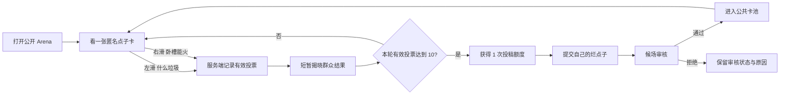

# PRD：我的烂点子 · 斯巴达角斗场（Trash Idea Arena）

> **P0 产品合同：** 这是一个无需注册的公开增长页面。访客查看独立开发者提交的荒谬 SaaS 点子，向左滑选择“什么垃圾”，向右滑选择“卧槽能火”。每完成 10 个由服务端确认、且针对不同点子的有效投票，访客获得 1 次匿名投稿额度；成功提交后消耗 1 个额度，投稿先进入候场审核，审核通过后才进入公共卡池。
>
> **匿名边界：** “无需注册”不等于“没有身份”。P0 使用服务端签发的高熵 HttpOnly Cookie 保存匿名进度，不采集姓名、邮箱、手机号，也不做浏览器指纹。清理 Cookie、换浏览器或换设备会丢失进度；攻击者也可借助清 Cookie、代理或多设备绕过一次性限制。因此 10 次投票是游戏规则和内容互惠机制，不是强身份或安全权限。
>
> **默认决策：** 用户没有指定永久投稿权、审核方式、内容语言和运营归属。为形成可上线的闭环，本文采用以下推荐默认值：每 10 个有效投票换 1 个投稿额度；投稿不自动公开；中英文页面分流并优先展示同语言内容；Arena 归属一个由服务端配置的运营 Workspace，复用现有 Workspace Owner/Admin 权限做审核。若后续没有调整，实现以这些默认决策为准。

## 0. Implementation Status（2026-08-26）

本 PRD 的 P0 纵向链路已在当前工作区完成本地实现：数据库模型与并发索引迁移、匿名 HttpOnly capability、服务端计票/额度/幂等、双语公开滑卡页、匿名投稿与撤回、举报、Owner/Admin 审核状态机、编辑种子、Web/Desktop 共享审核页、保留 slug、sitemap 与部署配置均已接线。

- 公开页面：`/arena`、`/zh-cn/arena`。
- 审核页面：`/{workspaceSlug}/arena-moderation`（Web 与 Desktop）。
- 功能开关：`ITEAMIFY_TRASH_IDEA_ARENA_ENABLED`、`ITEAMIFY_TRASH_IDEA_ARENA_WORKSPACE_ID`；缺少合法 Workspace ID 时 fail closed。
- 本地验证：Go service/handler/router/migrator 测试、Core/Web 路由测试、Core/Views/Web/Desktop 类型检查、相关 lint，以及 1440px/390px 浏览器验收。
- 尚未执行外部状态变更：未对任何数据库运行迁移、未开启生产功能开关、未创建生产种子，也未做部署后真实 PostgreSQL + Redis 的十票完整 E2E。分析事件/业务仪表盘属于上线前 observability 收口项，不阻塞本地功能链路，但不能视为已完成。

## 1. Introduction / Overview

### 1.1 背景与机会

独立开发者通常有两个高频但低结构化的需求：

- 快速评价别人的产品想法，获得轻量娱乐和参与感。
- 在真正投入开发前，得到对自己想法的第一层情绪反馈。

传统“提交想法”页面的问题是供给先行、反馈滞后：新访客没有理由先贡献自己的内容，也无法保证后来者愿意评价。Trash Idea Arena 把顺序反过来：**先判断别人，再获得投稿机会**。每次左右滑都是成本极低的内容消费，同时为平台积累一条结构化反馈；第 10 次投票把即时娱乐自然过渡为投稿行为。

它不是商业可行性评估工具，也不是项目投融资打分。它提供的是“第一眼直觉”——一种有趣、低成本但不应被包装成市场验证的数据。

### 1.2 与当前项目的结合点

当前仓库已经有适合承载本功能的基础：

| 当前能力 | 相关代码位置 | 对本功能的意义 |
| --- | --- | --- |
| 公开营销路由不加载完整产品运行时 | `apps/web/app/(landing)/`、`apps/web/components/app-shell.tsx` | Arena 可保持轻量，不初始化 Workspace、WebSocket 和完整应用字典 |
| 营销页面已有中英文路径和字典 | `apps/web/features/landing/i18n/`、`apps/web/lib/marketing-i18n.ts` | 可提供 `/arena` 与 `/zh-cn/arena`，不另建一套语言机制 |
| 已有公开 API、严格生产限流与匿名 capability 经验 | `server/cmd/server/router.go`、`server/internal/handler/public_expert_security.go` | 可复用同源校验、可信代理 IP、Redis 严格写限流和高熵 Cookie 模式 |
| Workspace Owner/Admin 权限成熟，但没有全局 platform-admin | `server/internal/handler/handler.go` 及成员权限中间件 | Arena 运营审核应归属配置的 Workspace，而不是发明未存在的全局管理员 |
| API 响应要求 zod 解析和兼容回退 | `packages/core/api/schema.ts`、`packages/core/api/schemas.ts` | 所有新前端响应必须经过 schema，不直接断言网络 JSON 类型 |
| 数据库禁止外键/级联，索引必须并发创建 | 根目录 `CLAUDE.md`、`server/migrations/` | Arena 表关系由服务层校验；每个索引使用独立的 `CREATE [UNIQUE] INDEX CONCURRENTLY` 迁移 |

### 1.3 核心产品闭环



闭环成立依赖三个条件：

1. **消费足够快：** 每张卡只要求一个二选一判断，10 次应在 90 秒内完成。
2. **反馈有回报：** 投票后才揭晓聚合结果，避免从众偏差，也给用户即时奖励。
3. **供给不失控：** 投稿额度与有效投票绑定，且公开前审核，避免一旦解锁就无限灌水。

### 1.4 关键产品决策

| 决策项 | P0 选择 | 原因 | 明确代价 |
| --- | --- | --- | --- |
| 公开路径 | `/arena`、`/zh-cn/arena` | 单词级全局路由符合仓库约定，易传播 | 需把 `arena` 加入保留 slug 并生成前端映射 |
| 身份 | 高熵匿名 capability Cookie | 无注册、刷新后可恢复、服务端可校验 | 清 Cookie 或换设备会重置，不是强防刷身份 |
| 解锁模型 | 每 10 个不同点子的有效投票换 1 个投稿额度 | 保持内容互惠并限制垃圾投稿 | 比“一次解锁永久投稿”多一层约束 |
| 结果展示 | 投票前隐藏，投票后展示 | 减少从众；提供即时奖励 | 用户无法先看热度再决定 |
| 投稿状态 | `pending` 后人工审核 | 公开 UGC 必须防诽谤、隐私、仇恨和广告 | 需要运营响应 SLA |
| 作者身份 | P0 全匿名，不展示昵称、链接或联系方式 | 降低注册和隐私负担，让评价聚焦点子 | 无个人品牌曝光和站外导流 |
| 内容语言 | 页面语言优先，同语言不足时有标记地回退 | 避免随机混杂，同时保护卡池可用性 | 冷启动需准备双语种子内容 |
| 运营权限 | 配置的 Arena Workspace Owner/Admin | 复用真实权限模型与审计边界 | 需要部署配置和运营 Workspace |
| 客户端范围 | 公开 Web + Web/Desktop 共用审核页 | 公共增长入口以浏览器为主，内部审核复用共享架构 | 不做原生移动端 Arena |

## 2. Goals

- 让首次访问者无需注册即可在 5 秒内理解规则并完成第一次投票。
- 让 10 次连续投票在正常网络下的中位完成时间小于 90 秒。
- 用服务端确认的不同点子投票累计解锁进度，重复请求和重复点子不能增加进度。
- 在第 10 个有效投票后立即获得 1 个投稿额度，不需要登录、邮箱或二次跳转。
- 让访客用最多 3 个核心字段完成匿名投稿，并得到明确的候场状态。
- 让公开内容在发布前经过审核；用户输入不以 HTML 执行，不进入日志和分析事件。
- 建立从页面访问、首投、十投解锁、打开投稿、提交、审核到被投票的完整漏斗。
- 保持页面轻量、移动端优先、支持鼠标、触摸、键盘和减少动态效果偏好。
- 让生产环境的匿名写入口在共享限流不可用时 fail closed，避免失控写入。

## 3. Non-goals / Out of Scope

- P0 不创建账号、用户资料、开发者主页或社交关系。
- P0 不要求登录，也不把已登录用户的 `user_id` 绑定到 Arena 匿名身份。
- P0 不提供评论、私信、关注、收藏、排行榜或公开作者昵称。
- P0 不提供 AI 商业分析、收入预测、技术可行性评分或“值得做”的权威结论。
- P0 不把“卧槽能火”比例宣传成用户研究、PMF 或投资建议。
- P0 不提供投票撤销；失败请求除外，失败时原卡必须恢复。
- P0 不支持图片、附件、Markdown、富文本、外链、邮箱、手机号或社交账号。
- P0 不为单个点子生成可索引详情页或独立分享海报。
- P0 不做自动翻译；内容保留投稿语言。
- P0 不自动公开投稿，也不以纯 AI 审核替代人工发布决定。
- P0 不承诺“一人一票”。匿名 Cookie + IP 限流只做与娱乐产品风险匹配的 best-effort 防滥用。
- P0 不做原生 iOS/Android/Electron 公开滑卡入口。
- P0 不做付费置顶、广告、赞助卡或商业化。

## 4. Personas

### P-001：围观型独立开发者

想在碎片时间快速判断荒谬产品点子，不愿注册，也不想阅读长篇项目介绍。核心动机是娱乐、表达判断和与“群众直觉”对比。

### P-002：验证型独立开发者

有一个不成熟甚至尴尬的 SaaS 想法，希望用低心理负担匿名投放，观察第一批直觉反馈。核心动机是“先试水，不暴露身份”。

### P-003：Arena 运营审核员

是配置的 Arena Workspace 的 Owner/Admin，负责准备冷启动种子、处理候场投稿、归档违规内容和查看内容供给健康度。

## 5. End-to-end User Experience

### 5.1 首次访问

1. 访客打开 `/zh-cn/arena` 或 `/arena`。
2. 首屏显示品牌、1 句规则、`0 / 10` 进度和第一张卡；不弹注册、不先弹表单。
3. 卡片只展示点子标题、一句话说明、目标用户和类别，不展示投票比例。
4. 首次有效左/右滑或点击按钮时，前端调用投票 API。
5. 服务端在同一事务中创建匿名访客、记录投票并返回 HttpOnly Cookie；空浏览、爬虫预取和仅拉取卡片不创建访客记录。

### 5.2 连续投票

1. 用户将卡向左拖动时，显示“什么垃圾”文字印章；向右拖动时显示“卧槽能火”。
2. 越接近提交阈值，卡片旋转和印章透明度越明显；未越过阈值时松手回弹。
3. 越过阈值后卡片退出，前端提交一次投票；同一时间只允许一个投票写请求在途。
4. 服务端成功后显示约 600–900ms 的结果反馈：
   - 有效样本少于 5 票：`样本还少 · 共 3 票`。
   - 至少 5 票：`68% 的人觉得能火 · 共 25 票`。
5. 进度只在服务端确认后增加。请求失败时原卡回到栈顶，显示可重试错误，不能假装已计数。
6. 下一张卡已预取时立即进入；不得一次把整个卡池下载到客户端。

### 5.3 第 10 次投票与解锁

1. 第 10 个有效投票的服务端响应返回 `available_submission_credits = 1`。
2. 进度条完成，并显示一次短促的“闸门开启”微互动；遵守 `prefers-reduced-motion` 时只切换文案和透明度。
3. 主操作变为“把我的烂点子扔进场”，用户可立即打开投稿 Sheet，也可继续投票。
4. 每新增 10 个有效投票再增加 1 个投稿额度；额度可累计。

### 5.4 匿名投稿

投稿表单只包含：

- `点子名`：4–60 个 Unicode 字符，必填。
- `一句话怎么运作`：20–280 个 Unicode 字符，必填。
- `谁会倒霉地用它`：2–80 个 Unicode 字符，必填。
- `类别`：`AI | 开发者工具 | 效率 | 营销销售 | 消费产品 | 其他`，必选。
- 内容规则确认：确认不包含真实个人信息、攻击、仇恨、违法内容、联系方式或外链，必选。

提交行为：

1. 前端显示剩余字符和明确的字段级错误。
2. 服务端重新规范化并验证所有字段，计算规范化内容哈希，检查明显重复。
3. 仅当访客有可用额度且没有正在审核的投稿时，服务端在一个事务中插入 `pending` 投稿并消耗 1 个额度。
4. 成功页显示：`已送进候场区。通过审核后，它才会挨打。`，以及剩余投稿额度。
5. 同一个 `client_submission_id` + 相同 payload 重试返回原结果，不重复耗额度；相同 ID + 不同 payload 返回 409。
6. 验证失败、重复内容或服务端失败不消耗额度。
7. 审核拒绝默认不自动退额度，防止攻击者反复提交；审核员可对误判执行有审计记录的额度退还。

### 5.5 返回访问

- Cookie 有效时，页面恢复已投票排除集、当前进度、可用额度和本人最近投稿状态。
- 页面不显示历史投票明细，只显示累计进度和最近投稿状态。
- Cookie 丢失时按新匿名访客处理，不提供邮箱或账号找回。
- 匿名 capability 过期时间为最后活动后 180 天；每次有效写操作可滑动续期，但不超过产品配置的最大保留策略。

### 5.6 卡池不足与故障

- 同语言可投卡少于 3 张时，可回退到另一语言，并明确显示语言标签。
- 所有语言合计不足以完成下一次解锁时，显示 `今晚先打到这里，新斗士正在候场`，保留当前进度，不用假数据补齐。
- 功能关闭时返回稳定的不可用状态，页面展示品牌化维护文案，不回退到登录页。
- 写限流时显示 `手速太快，歇一会再挥剑` 和服务端 `Retry-After`；不得静默丢票。

## 6. User Stories

### US-001：建立 Arena 数据模型和约束

**Description:** 作为开发者，我需要持久化匿名访客、点子、投票、投稿额度、举报和审核记录，以便服务端成为游戏进度和公开内容的唯一事实源。

**Acceptance Criteria:**

- [ ] 新增 `trash_idea_visitor`、`trash_idea`、`trash_idea_vote`、`trash_idea_report`、`trash_idea_review` 表，所有表包含服务端派生的 `workspace_id`。
- [ ] 表之间不使用数据库外键或级联动作；服务层在事务中校验 Workspace、visitor、idea 和 review 关系。
- [ ] `trash_idea_vote` 以唯一索引保证同一 visitor 对同一 idea 只能产生一个有效 verdict。
- [ ] 每个表的主键/唯一索引/查询索引使用独立单语句迁移中的 `CREATE [UNIQUE] INDEX CONCURRENTLY`；需要主键约束时后续用 `PRIMARY KEY USING INDEX` 收口。
- [ ] `verdict` 只允许 `trash | fire`；idea 状态只允许 `pending | published | rejected | archived | withdrawn`。
- [ ] 发布态点子的聚合计数是可重建投影，`trash_idea_vote` 是投票事实源。
- [ ] sqlc 生成和真实 PostgreSQL 迁移/回滚测试通过。

### US-002：签发和恢复匿名 Arena 身份

**Description:** 作为无需注册的访客，我希望刷新页面后仍能保留进度，以便完成 10 次投票和投稿。

**Acceptance Criteria:**

- [ ] 第一次有效写操作才创建 visitor；页面浏览和 feed GET 不创建数据库 visitor。
- [ ] 服务端生成至少 256 位随机 capability，数据库只保存 SHA-256/HMAC 等固定长度安全哈希，不保存或记录明文。
- [ ] Cookie 使用 `HttpOnly; SameSite=Lax; Path=/api/public/arena`，生产使用 `Secure`，省略 `Domain`，最大有效期 180 天。
- [ ] Cookie 不进入 URL、localStorage、分析事件、应用日志或错误消息。
- [ ] 伪造、过期、被封禁 capability 不泄漏存在性；服务端清理无效 Cookie，并按新访客规则处理可安全重试的请求。
- [ ] 已登录成员访问 Arena 时仍使用独立匿名身份，响应不返回 Workspace 或用户内部信息。
- [ ] 安全测试覆盖 token 猜测、哈希存储、过期、撤销、Cookie 属性和跨路径使用。

### US-003：提供无重复的公共卡片 feed

**Description:** 作为访客，我希望持续看到尚未评价过的点子，以便快速完成一轮 10 次判断。

**Acceptance Criteria:**

- [ ] `GET /api/public/arena/feed` 只返回配置 Arena Workspace 中 `published` 的公开字段。
- [ ] 有有效 Cookie 时排除该 visitor 已投点子和本人投稿；无 Cookie 时不返回内部 visitor 状态。
- [ ] feed 优先当前页面语言；不足时回退另一语言并返回明确 `content_locale`。
- [ ] 每次最多返回 3 张卡和一个 opaque cursor；客户端不能下载全量卡池或猜测审核中内容。
- [ ] 服务端从有上限的候选池做打散，不在不断增长的全表上使用无界 `ORDER BY random()`。
- [ ] 卡片不包含投票聚合、submitter visitor、审核记录、内部 ID 或 Workspace ID。
- [ ] cursor 伪造、过期和未来版本返回稳定错误或重新开始，不泄漏 SQL/内部状态。
- [ ] API schema 漂移测试覆盖缺失字段、未知类别和未知状态的安全回退。

### US-004：实现触摸、鼠标和键盘一致的滑卡交互

**Description:** 作为访客，我希望用左右滑或等价按钮快速判断点子，以便交互简单、爽快且没有学习成本。

**Acceptance Criteria:**

- [ ] 桌面鼠标、触摸 Pointer Events、左/右方向键和两个显式按钮均可完成同一动作。
- [ ] 只有水平位移超过卡宽 28% 或水平速度超过 700px/s 且方向明确时提交；其余情况回弹。
- [ ] 同一时刻只允许一个投票请求在途，长按、双击和重复 pointer-up 不产生多票。
- [ ] 拖动时卡片最大旋转不超过 8°，左右印章同时使用图标和文字，不能只依赖颜色。
- [ ] `prefers-reduced-motion` 下关闭旋转、弹簧和大位移动画，使用短淡入淡出。
- [ ] 操作按钮至少 44×44 CSS px；焦点可见；`aria-live` 宣布 verdict、结果和 `n / 10` 进度。
- [ ] 320px 宽屏无横向溢出，390px 手机首屏能看到完整主要卡片和两枚操作按钮。
- [ ] 失败投票恢复原卡和焦点，成功前不增加解锁进度。
- [ ] TypeScript typecheck、组件交互测试通过。
- [ ] Verify in browser using dev-browser/browser skill.

### US-005：幂等记录投票并原子计算投稿额度

**Description:** 作为访客，我希望每个有效判断准确计数，以便第 10 次投票可靠解锁投稿。

**Acceptance Criteria:**

- [ ] `POST /api/public/arena/votes` 接收 `idea_ref`、`verdict`、`client_vote_id`，不接受客户端提供 visitor/workspace/count。
- [ ] 只有对当前 `published` 且非本人提交的点子的新投票才增加 `qualified_vote_count`。
- [ ] 相同 visitor + idea + verdict 重试返回 `replayed=true`，不重复增加计数；相同 visitor + idea 的相反 verdict 返回 409。
- [ ] 可用额度由 `floor(qualified_vote_count / 10) - spent_credit_count` 决定，永不接受客户端自报进度。
- [ ] 第 10、20、30…个有效投票各产生 1 个额度，多个请求并发时不多发、不漏发。
- [ ] 投票事实插入、visitor 计数更新和 idea 聚合投影更新在一个数据库事务中完成。
- [ ] API 仅在投票成功后返回该点子的总票数与 `fire` 比例；投票前 feed 不返回结果。
- [ ] 真实 PostgreSQL 并发测试覆盖第 10 票竞争、重复重试、相反 verdict 和已归档点子。

### US-006：解锁并提交匿名点子

**Description:** 作为完成 10 次投票的访客，我希望立即匿名提交自己的点子，以便获得群众第一眼反馈。

**Acceptance Criteria:**

- [ ] 没有可用额度时投稿入口显示锁定进度，直接调用提交 API 返回 403 `submission_locked`。
- [ ] 表单字段、长度、类别和内容规则确认按 5.4 执行；所有内容以纯文本存储和渲染。
- [ ] 服务端拒绝 HTML/脚本、URL、邮箱、手机号等明显联系方式以及规范化后的完全重复投稿。
- [ ] 同一 visitor 同时最多存在 1 个 `pending` 投稿。
- [ ] 成功插入 `pending` 投稿与 `spent_credit_count + 1` 在同一事务提交。
- [ ] `client_submission_id` 重试幂等；服务端失败、校验失败和判定重复时不消耗额度。
- [ ] 响应只返回 opaque `submission_ref`、状态、剩余额度和安全的公开回显，不返回内部 ID。
- [ ] 页面成功后仍可继续投票，不强制注册或跳转到产品 Dashboard。
- [ ] TypeScript typecheck、表单测试、API 并发测试通过。
- [ ] Verify in browser using dev-browser/browser skill.

### US-007：查看和撤回自己的候场投稿

**Description:** 作为匿名投稿者，我希望在当前浏览器看到最近投稿状态，并在公开前撤回，以便保留基本控制权。

**Acceptance Criteria:**

- [ ] 有效 Cookie 可以读取本 visitor 最近投稿的 `pending | published | rejected | withdrawn` 状态和用户可见原因类别。
- [ ] 只允许在 `pending` 时撤回；撤回幂等且不自动退还额度。
- [ ] 读取和撤回均联合校验 capability、workspace 和 submitter visitor，不能仅凭 `submission_ref` 操作。
- [ ] 页面明确说明 Cookie 丢失后无法找回或证明匿名投稿所有权。
- [ ] 审核内部备注、审核员身份、封禁原因和其他 visitor 数据不进入公共响应。
- [ ] Verify in browser using dev-browser/browser skill.

### US-008：提供受 Workspace 权限保护的候场审核

**Description:** 作为 Arena 运营审核员，我希望查看、发布、拒绝或归档点子，以便公开卡池安全且持续有内容。

**Acceptance Criteria:**

- [ ] 新增共享审核页 `/{workspaceSlug}/arena-moderation`，Web 与 Desktop 均通过平台适配器接入。
- [ ] 仅配置的 `ITEAMIFY_ARENA_WORKSPACE_ID` 对应 Workspace 的 Owner/Admin 可访问；其他 Workspace 成员即使是 Admin 也返回 404/403 的稳定响应。
- [ ] 审核列表默认显示 `pending`，支持按语言、类别、状态和创建时间筛选。
- [ ] 审核员可执行 `publish | reject | archive | restore | refund_credit`；高风险动作要求填写原因。
- [ ] 发布前服务端再次执行长度、联系方式、重复和安全规则，不能只信前端审核页。
- [ ] 每次动作写入不可变 `trash_idea_review` 审计记录，包含 actor、前后状态、reason code 和时间。
- [ ] 乐观并发使用 idea `version`；旧版本操作返回 409，不覆盖另一审核员的新决定。
- [ ] 审核页可创建明确标记为 `editorial_seed` 的种子点子，但不能伪装成访客投稿。
- [ ] 页面不展示 capability、IP 或不必要的访客标识。
- [ ] 共享组件测试、权限测试、Web/Desktop 路由测试通过。
- [ ] Verify in browser using dev-browser/browser skill.

### US-009：举报已发布点子并安全降级

**Description:** 作为访客，我希望举报包含隐私、攻击或违法内容的点子，以便 Arena 不放大伤害。

**Acceptance Criteria:**

- [ ] 已发布卡片提供次级“举报”入口，不干扰左右滑主操作。
- [ ] 原因只允许 `personal_data | harassment | hate | illegal | spam | copied | other`；`other` 可附 0–200 字说明。
- [ ] 同一 visitor 对同一 idea 只能保留一条有效举报；重试幂等。
- [ ] 举报不会自动影响投票结果，也不会仅凭单次举报自动下架。
- [ ] 达到可配置的不同 visitor 阈值时标记 `needs_review` 并通知审核队列；严重内容可由审核员立即归档。
- [ ] 举报内容和 idea 正文不进入分析事件或普通应用日志。
- [ ] 写限流、跨 idea 伪造和归档后举报有测试覆盖。
- [ ] Verify in browser using dev-browser/browser skill.

### US-010：建立冷启动内容和发布门禁

**Description:** 作为运营人员，我需要在公开发布前准备足够的原创种子点子，以便每个新访客都能完成 10 次投票。

**Acceptance Criteria:**

- [ ] 首次开启 Arena 前至少有 30 条中文和 30 条英文已发布原创种子点子，目标为每种语言 50 条。
- [ ] 种子内容通过审核页创建并标记 `editorial_seed`，不抓取或冒充真实开发者投稿。
- [ ] 启用检查验证配置 Workspace 存在、Owner/Admin 可用、两种语言各至少 30 条发布内容、Redis 严格写限流可用。
- [ ] `ITEAMIFY_TRASH_IDEA_ARENA_ENABLED=false` 时公共写 API 返回 503 稳定错误，审核和数据不被删除。
- [ ] 回滚功能开关不会回滚迁移或丢失已经记录的投票和投稿。

### US-011：记录漏斗和运行指标

**Description:** 作为产品负责人，我希望知道用户在哪一步离开以及卡池是否健康，以便判断玩法是否值得继续投入。

**Acceptance Criteria:**

- [ ] 记录 9.1 定义的漏斗事件和 9.2 定义的服务指标。
- [ ] 分析事件只携带枚举、计数、语言、类别和内部 opaque ID，不携带点子正文、举报说明、Cookie、IP 或审核备注。
- [ ] 服务端确认型事件以数据库成功为准；客户端动画触发不能冒充 `vote_recorded` 或 `submission_created`。
- [ ] 重试幂等事件只记录一次业务成功；`replayed=true` 不重复计入投票漏斗。
- [ ] 监控可区分验证失败、重复、锁定、限流、审核拒绝和 5xx。
- [ ] 仪表盘能看到“有至少 10 张未投卡可用”的匿名会话比例和按语言卡池深度。

### US-012：完成可访问性、性能和端到端验收

**Description:** 作为发布负责人，我希望在真实浏览器和真实数据库中验证完整闭环，以便避免只在组件测试里成立。

**Acceptance Criteria:**

- [ ] Playwright 覆盖无 Cookie 首投签发、连续 10 个不同投票、解锁、投稿、审核发布、另一个访客投票的完整链路。
- [ ] Playwright 覆盖按钮和键盘路径，不只覆盖拖拽。
- [ ] 真实 PostgreSQL 测试证明并发第 10 票只产生一个新额度，幂等投稿只消耗一次额度。
- [ ] 390×844、320×568 和桌面视口完成视觉验收，无横向滚动或操作遮挡。
- [ ] Lighthouse mobile 本地基线：Performance ≥ 90、Accessibility ≥ 95；单独记录本地结果，不把它表述为生产 RUM。
- [ ] 生产发布后单独验证页面/API 可用性、真实限流、错误率和 p75 LCP；本地通过不等于生产验收。
- [ ] TypeScript typecheck、相关 Vitest、Go tests、sqlc diff 和迁移验证通过。
- [ ] Verify in browser using dev-browser/browser skill.

## 7. Functional Requirements

### 7.1 路由与页面

- **FR-1:** 系统必须提供英文 `/arena` 和简体中文 `/zh-cn/arena`，二者设置 canonical/hreflang 并进入营销 sitemap。
- **FR-2:** `arena` 必须加入 `server/internal/handler/reserved_slugs.json`，执行 `pnpm generate:reserved-slugs` 并提交生成文件。
- **FR-3:** 公共 Arena 必须位于轻量营销 route group，不得加载完整 AppShell、成员 `/me`、Workspace 列表或内部 WebSocket。
- **FR-4:** 页面必须可被搜索引擎索引，但点子不得拥有 P0 可索引详情 URL；Open Graph 使用固定 Arena 品牌素材，不拼接 UGC。
- **FR-5:** 功能开关关闭、卡池为空、feed 耗尽、限流和服务异常必须各有稳定可测试状态。

### 7.2 匿名身份与进度

- **FR-6:** 服务端只能在第一次合法写操作时创建 visitor 并签发 capability Cookie。
- **FR-7:** 客户端不得写入或读取明文 capability；浏览器只通过 `credentials: same-origin` 自动携带 Cookie。
- **FR-8:** 访客有效票数以不同 `idea_id` 的已提交 vote 行为准，不能以动画次数、卡片曝光或本地计数为准。
- **FR-9:** 可用投稿额度必须按 `floor(qualified_vote_count / 10) - spent_credit_count` 在服务端计算，最小为 0。
- **FR-10:** 清 Cookie 后系统按新 visitor 处理；产品文案必须诚实说明不支持跨设备恢复。

### 7.3 Feed 与卡片

- **FR-11:** Feed 只能返回 `published`、未被当前 visitor 投票、非当前 visitor 投稿的点子。
- **FR-12:** 卡片公开字段只包含 `idea_ref`、title、pitch、target_user、category、content_locale 和 source label。
- **FR-13:** 聚合投票结果只能在该 visitor 成功投票后的响应中返回，不得随未投 feed 返回。
- **FR-14:** 少于 5 票时不得显示易误导的百分比，只显示样本不足和总票数。
- **FR-15:** Feed 必须使用有界候选池 + 服务层打散，避免无界全表随机排序。
- **FR-16:** 客户端最多预取 3 张卡；当前卡未结算时不得发送下一票。

### 7.4 投票

- **FR-17:** Verdict 只允许 `trash` 和 `fire`，显示文案分别本地化为“什么垃圾/卧槽能火”和“Trash it/Could blow up”。
- **FR-18:** 每次投票必须带客户端生成的 idempotency ID；服务端还必须用 visitor + idea 唯一约束兜底。
- **FR-19:** 同一 visitor 对同一 idea 不允许改变投票；P0 没有撤销。
- **FR-20:** Idea 在卡片加载后被归档时，投票 API 必须拒绝且不增加进度。
- **FR-21:** 投票成功、visitor 进度和 idea 聚合投影必须原子提交。

### 7.5 投稿

- **FR-22:** 投稿 API 必须先锁定 visitor 行并在事务中校验可用额度，不能先消费再插入或先插入再异步消费。
- **FR-23:** 投稿必须以 `pending` 创建，不能由客户端指定为 `published`。
- **FR-24:** 相同 visitor 同时最多有 1 条 `pending`；其余额度保留。
- **FR-25:** 所有字段在服务端执行 Unicode 规范化、首尾空白处理、长度验证和纯文本转义。
- **FR-26:** 规范化内容哈希完全重复时返回重复结果，不消耗额度；近似重复可以进入审核队列并提示审核员。
- **FR-27:** 投稿成功后只返回安全状态，不返回审核员、Workspace 或内部数据库标识。

### 7.6 审核与举报

- **FR-28:** 所有管理 API 必须从认证会话获取 actor，并校验其为配置 Arena Workspace 的 Owner/Admin。
- **FR-29:** 审核动作必须通过服务端状态机，不允许 `rejected -> published` 绕过 restore/re-review 语义。
- **FR-30:** 每次审核动作必须写不可变审计记录；idea 当前状态只是最新投影。
- **FR-31:** 公开渲染只允许纯文本；任何 HTML、Markdown 或 URL 不产生可点击/可执行内容。
- **FR-32:** 举报达到阈值只提升审核优先级，不把“群众举报”直接当违规事实。
- **FR-33:** 审核员可归档已发布点子；归档后新 feed 和新投票立即停止，历史票保留。

### 7.7 安全、限流与隐私

- **FR-34:** 所有写请求必须检查同源 Origin、JSON Content-Type、body 大小、字段长度和 CSRF 边界；公共 API 不开放跨域 credentialed CORS。
- **FR-35:** 生产投票、投稿、举报写入口必须使用 Redis 共享限流并在 Redis 不可用时 fail closed。
- **FR-36:** 初始建议限流为：投票每 IP 60/min、每 visitor 30/min；投稿每 visitor 3/day、每 IP 10/day；举报每 visitor 10/hour。数值必须可配置并有上限保护。
- **FR-37:** 服务端必须使用可信代理配置解析 IP，不能信任任意来源的 `X-Forwarded-For`。
- **FR-38:** 数据库不保存原始 IP、User-Agent 指纹或浏览器指纹；限流基础设施按既有策略保存短期计数。
- **FR-39:** 日志不得输出点子正文、举报说明、capability Cookie 或完整请求 body。
- **FR-40:** 拒绝/撤回且未发布的投稿正文保留 90 天后清理；审核审计保留不含正文的最小元数据。已发布内容按运营归档策略保留。

### 7.8 交互与可访问性

- **FR-41:** 左右滑必须有同等功能的按钮和键盘替代，手势不是唯一操作方式。
- **FR-42:** 进度、错误、投票结果和解锁状态必须向辅助技术宣布。
- **FR-43:** 不得仅用红/绿表达 verdict；文字、图标和形状必须同时区分。
- **FR-44:** 尊重 reduced motion，拖拽期间不得阻止页面必要的纵向滚动。
- **FR-45:** 在任何网络错误下，UI 展示的票数和额度都必须回到服务端事实状态。

## 8. Design Considerations

### 8.1 视觉方向

视觉关键词：**极简、残酷、幽默、像一张被扔进竞技场的产品便签**。

- 背景使用骨白/纸张质感的纯 CSS 轻纹理，主体为深墨色；左右 verdict 使用两种高对比强调色，但不做写实罗马竞技场插画。
- 卡片居中，移动端占主要视区；桌面保持约 420–480px 宽的单列舞台，不把它扩展成 Dashboard。
- 标题层级建议：`我的烂点子` 为品牌主标题，`斯巴达角斗场` 为解释性副标题；英文统一为 `Trash Idea Arena`。
- 卡片排版优先点子名和一句话说明；类别是小标签，目标用户是次要信息。
- 右上角提供简短“规则”入口，说明：评价的是点子，不是人；结果是群众直觉，不是市场验证。

### 8.2 关键微互动

- 拖动 0–28%：卡片跟手移动，印章透明度随距离增加。
- 达阈值：触发一次轻量视觉确认，不依赖震动 API。
- 服务端成功：卡片飞出，结果条从底部短暂浮现，进度点亮一格。
- 第 10 票：10 格进度合拢为“投稿通行证”；reduced motion 下直接切换状态。
- 提交成功：表单折叠为候场票据，不用彩带或大型庆祝动画抢走“继续滑”的节奏。

### 8.3 文案原则

- 可以毒舌，但只能评价点子，不能鼓励攻击投稿者。
- 中文保留用户指定的“什么垃圾”“卧槽能火”，其他文案克制，避免每个角落都堆梗。
- 结果固定附带免责声明短句：`群众第一眼，不是市场证明。`
- 审核拒绝使用中性 reason category，不向匿名用户展示内部安全细节。

### 8.4 页面状态清单

| 状态 | 主界面 | 主要操作 |
| --- | --- | --- |
| Loading | 卡片骨架 + 已知规则 | 无 |
| Ready | 顶层卡 + 下一张轮廓 | 左滑、右滑、按钮、键盘 |
| Dragging | 跟手卡 + verdict 印章 | 松手提交/回弹 |
| Vote pending | 卡退出或停在边缘，后续操作暂禁 | 等待，不重复提交 |
| Result reveal | 结果条 + 新进度 | 自动进入下一卡 |
| Unlocked | 投稿通行证 + 卡栈 | 打开投稿/继续投票 |
| Submit pending | 表单提交中 | 防重复提交 |
| Submitted | 候场票据 + 剩余额度 | 继续投票 |
| Feed exhausted | 收摊空状态 + 当前进度 | 稍后再来 |
| Rate limited | 当前卡保留 + Retry-After | 倒计时后重试 |
| Disabled | 品牌化维护页 | 返回首页 |

## 9. Measurement

### 9.1 事件定义

| Event | 触发事实 | 关键属性（不含正文/PII） |
| --- | --- | --- |
| `arena_viewed` | 页面可见 | locale、referrer bucket、utm |
| `arena_first_card_seen` | 第一张卡完成渲染 | locale、content_locale |
| `arena_vote_recorded` | 新 vote 事务提交 | verdict、vote_index_bucket、category、content_locale |
| `arena_unlock_earned` | 有效票数首次跨越 10 的倍数 | credit_ordinal、seconds_since_first_vote bucket |
| `arena_submit_opened` | 投稿 Sheet 打开 | available_credit_count |
| `arena_submission_created` | pending 投稿事务提交 | category、content_locale、credits_remaining |
| `arena_submission_reviewed` | 审核事务提交 | action、reason_code、queue_age_bucket |
| `arena_idea_reported` | 新举报事务提交 | reason_code、category |
| `arena_feed_exhausted` | 无可投卡 | requested_locale、fallback_used、progress_bucket |

分析事件不得携带 title、pitch、target_user、举报说明、capability、IP、审核备注或表单原文。

### 9.2 运行指标

- Feed、vote、submit、report 的 QPS、p50/p95 延迟、4xx 分类和 5xx。
- 投票幂等重放率、相反 verdict 冲突率、限流率。
- 每种语言 `published/pending/needs_review/archived` 卡池深度。
- 有效 visitor 中拥有至少 10 张未投卡的比例。
- 审核队列年龄 p50/p95、24 小时未处理数量。
- 举报率、审核拒绝率、人工退额度次数。

### 9.3 P0 成功指标（上线后 30 天）

- 看到第一张卡的访客中，首投率 ≥ 55%。
- 完成首投的访客中，10 投完成率 ≥ 35%。
- 获得投稿额度的访客中，投稿创建率 ≥ 20%。
- 完成 10 投的中位时间 ≤ 90 秒。
- 至少 80% 的活跃匿名 visitor 随时有 10 张未投卡可用。
- Vote/submit API 5xx < 0.5%，投票 p95 < 500ms（不含客户端动画）。
- `published` 内容举报率 < 2%，高风险举报 24 小时内处理率 ≥ 95%。

这些是首轮评估阈值，不是对真实用户量的预测。样本不足时只报告原始人数和置信区间，不做百分比胜利宣告。

## 10. Technical Considerations

### 10.1 推荐代码落点

```text
apps/web/app/(landing)/arena/page.tsx
apps/web/app/(landing)/zh-cn/arena/page.tsx
apps/web/features/arena/
  components/arena-page-client.tsx
  components/idea-card.tsx
  components/submission-sheet.tsx
  arena.module.css
packages/core/arena/
  schemas.ts
  types.ts
  progress.ts
  queries.ts                 # 审核页 React Query；公开页不要求完整 AppShell
packages/views/arena-moderation/
apps/web/app/[workspaceSlug]/(dashboard)/arena-moderation/page.tsx
apps/desktop/.../routes.tsx  # 共享审核页平台接线
server/internal/handler/arena.go
server/internal/service/arena.go
server/pkg/db/queries/arena.sql
server/migrations/<next>_trash_idea_core.up.sql
server/migrations/<next>_trash_idea_<one-index>.up.sql
```

实施时使用当时的下一个迁移编号，不在 PRD 中预占 `437+`，避免与并行工作冲突。

### 10.2 页面运行时边界

- 公共页面放在 `(landing)`，服务端渲染标题、规则和卡片容器；滑动、feed 和投稿是小型 Client Component island。
- 公共页面不使用完整 `AppShell`。公开 API client 接受显式 fetch/base URL，并对响应执行 zod 解析；不得为了 React Query 把整个产品 provider 引入营销页。
- 共享 `packages/core/arena` 保持 headless：不使用 `react-dom`、`localStorage` 或 `process.env`。
- 审核页属于成员产品面，使用 React Query 管理服务器状态，放入 `packages/views` 并由 Web/Desktop 路由适配器接入。
- 滑动阈值、进度计算和结果文案选择写成纯函数，便于单元测试；Pointer capture 和动画留在 Web 组件。

### 10.3 数据模型草案

#### `trash_idea_visitor`

- `id UUID`
- `workspace_id UUID`
- `capability_hash BYTEA(32)`
- `status active | blocked | expired`
- `qualified_vote_count INTEGER >= 0`
- `spent_credit_count INTEGER >= 0`
- `preferred_locale TEXT`
- `created_at / last_activity_at / expires_at`

#### `trash_idea`

- `id UUID`、`public_ref TEXT`
- `workspace_id UUID`
- `submitter_visitor_id UUID NULL`（种子为空）
- `source visitor | editorial_seed`
- `status pending | published | rejected | archived | withdrawn`
- `content_locale en | zh-Hans`
- `title / pitch / target_user / category`
- `normalized_content_hash BYTEA(32)`
- `trash_vote_count / fire_vote_count INTEGER >= 0`（可重建投影）
- `needs_review BOOLEAN`
- `version INTEGER`
- `created_at / published_at / updated_at`

#### `trash_idea_vote`

- `id UUID`、`workspace_id UUID`
- `visitor_id UUID`、`idea_id UUID`
- `verdict trash | fire`
- `client_vote_id TEXT`
- `created_at`

#### `trash_idea_report`

- `id UUID`、`workspace_id UUID`
- `visitor_id UUID`、`idea_id UUID`
- `reason_code`、`detail TEXT`
- `status open | reviewed | dismissed`
- `created_at / reviewed_at`

#### `trash_idea_review`

- `id UUID`、`workspace_id UUID`
- `idea_id UUID`、`actor_user_id UUID`
- `action publish | reject | archive | restore | refund_credit`
- `from_status / to_status / reason_code / note`
- `idea_version`
- `created_at`

所有 UUID 关系均为应用层软引用，不添加 `FOREIGN KEY` 或 cascade。删除/归档必须由服务层显式处理并写审计。

### 10.4 公共 API 草案

#### `GET /api/public/arena/feed`

Query：`locale`、`cursor?`、`limit<=3`。

返回：

```json
{
  "status": "available",
  "cards": [
    {
      "idea_ref": "tia_opaque",
      "title": "把 standup 做成抽卡游戏",
      "pitch": "每天抽到什么角色，就用什么语气汇报进度。",
      "target_user": "厌倦晨会的远程团队",
      "category": "productivity",
      "content_locale": "zh-Hans",
      "source": "visitor"
    }
  ],
  "next_cursor": "opaque",
  "progress": {
    "votes_in_current_cycle": 7,
    "threshold": 10,
    "available_submission_credits": 0
  }
}
```

无有效 Cookie 时 progress 为零，但 GET 不创建 visitor。

#### `POST /api/public/arena/votes`

```json
{
  "idea_ref": "tia_opaque",
  "verdict": "fire",
  "client_vote_id": "browser-generated-uuid"
}
```

成功返回 `accepted/replayed`、投票后聚合、可信 progress 和可选 next card。首次合法写响应同时设置 capability Cookie。

#### `POST /api/public/arena/submissions`

接收 5.4 字段、`rules_accepted=true`、`client_submission_id`。成功返回 `submission_ref`、`pending`、剩余额度。服务端忽略任何客户端传入的 status、counts、visitor 或 workspace 字段。

#### 其他公共接口

- `GET /api/public/arena/submissions/mine`：当前 visitor 最近投稿状态。
- `POST /api/public/arena/submissions/{submissionRef}/withdraw`：仅撤回自己的 pending 投稿。
- `POST /api/public/arena/ideas/{ideaRef}/reports`：创建幂等举报。

### 10.5 审核 API 草案

- `GET /api/workspaces/{id}/arena/ideas?status=pending&locale=&category=&cursor=`
- `POST /api/workspaces/{id}/arena/ideas`：创建 editorial seed。
- `POST /api/workspaces/{id}/arena/ideas/{ideaId}/review`：携带 `action`、`reason_code`、`note`、`expected_version`。

路径 `id` 必须使用已有 Workspace loader 解析；服务端再比对配置的 Arena Workspace。不能让客户端通过改 header/path 选择另一个运营数据集。

### 10.6 Feed 公平性与性能

P0 不直接按点赞率排序，因为这会让早期热门卡持续获得曝光，并使“验证”结果被位置偏差放大。推荐：

1. SQL 先选取当前 Workspace、语言、published、未投、非本人投稿的有界候选池。
2. 候选优先级以总票较少、较新且未被 `needs_review` 标记为主。
3. Go 服务层按 visitor/day seed 做稳定打散；无 visitor 时按请求级随机种子打散。
4. 每次只返回 3 张。后续根据真实规模再引入曝光表或专门推荐系统。

### 10.7 一致性与并发

- 投票事务应先解析/锁定 visitor，再插入唯一 vote，并原子增加 visitor 计数和 idea 聚合。
- 投稿事务锁定 visitor，计算可用额度，检查 pending，再插入 idea 和增加 `spent_credit_count`。
- 计数投影漂移时，以 vote 表重建，不反向修改 vote 事实。
- API handler 只负责解析/鉴权/映射错误；阈值、状态机、额度和审核规则放在 service 层。
- sqlc 能生成不代表 PostgreSQL 运行正确；投票和投稿并发路径必须有真实 PostgreSQL 回归。

### 10.8 SEO 与缓存

- 页面静态品牌内容可缓存；带 visitor 状态的 feed 响应使用 `Cache-Control: private, no-store` 和 `Vary: Cookie`。
- 公共 UGC API 响应不得被 CDN 公共缓存，避免把一个 visitor 的进度发给另一个 visitor。
- 页面 metadata 使用固定标题、描述和 OG 图；不把未经审核或动态点子内容放入 metadata。
- `/arena` 与 `/zh-cn/arena` 互设 hreflang；语言切换保持在 Arena，不跳首页。

## 11. Release Plan

### Phase 0：产品合同和冷启动内容

- 确认本文默认决策，尤其是“10 票换 1 个额度”和“投稿先审核”。
- 配置 Arena 运营 Workspace 和审核负责人。
- 编写并审核至少 30 条中文、30 条英文原创种子点子。
- 确认公开内容规则、拒绝 reason code、数据保留和运营 SLA。

### Phase 1：事实层和服务端纵切

- 建表、并发索引、sqlc 查询。
- 实现匿名 capability、feed、投票幂等、额度计算、投稿和举报 service。
- 实现 Workspace 受权审核 API 与审计。
- 完成真实 PostgreSQL 并发测试、安全测试和严格限流。

### Phase 2：公开滑卡页面

- 加 `/arena`、`/zh-cn/arena`、保留 slug、营销路由和 metadata。
- 完成响应式卡栈、手势/按钮/键盘、结果揭晓、进度和错误恢复。
- 完成匿名投稿 Sheet、状态恢复和 feed 耗尽体验。
- 运行组件、可访问性和浏览器视觉测试。

### Phase 3：审核面和运营指标

- 完成共享审核页与 Web/Desktop 接线。
- 导入经审核的 editorial seeds。
- 接入漏斗、运行指标和卡池健康监控。
- 进行举报、归档、恢复和额度退还演练。

### Phase 4：灰度与正式发布

- 先通过功能开关在生产只对运营团队开放。
- 验证生产 Redis 严格写限流、Cookie 属性、同源校验和数据库事务。
- 5% → 25% → 100% 放量；观察 5xx、限流、卡池深度和审核队列。
- 独立记录本地测试、已部署状态和生产/RUM 验收，不用任一层替代另一层。

## 12. Test Matrix

| 层级 | 必测场景 |
| --- | --- |
| Pure unit | 滑动阈值、速度方向、`floor(votes/10)-spent`、结果文案、语言回退 |
| Schema | 缺字段、未知 enum、malformed JSON、未来字段、fallback 不误解锁 |
| Service + PostgreSQL | 重复票、相反票、第 10 票并发、投稿并发、额度幂等、状态机、聚合重建 |
| Handler | Cookie 属性、Origin、body limit、限流、伪造 ref、跨 Workspace 审核 |
| Component | pointer、按钮、键盘、reduced motion、失败回卡、320/390px overflow |
| E2E | 新访客 10 投→投稿→审核→新访客看到并投票；Cookie 恢复；feed 耗尽 |
| Production acceptance | 页面/API 200、真实写入、Redis fail closed、p75 LCP、5xx、审核 SLA |

## 13. Risks and Mitigations

| 风险 | 影响 | P0 缓解 |
| --- | --- | --- |
| 清 Cookie/代理绕过票数门槛 | 重复投票、刷额度 | visitor + idea 唯一约束、IP/visitor 双限流、审核、承认不是一人一票 |
| 冷启动卡池太少 | 用户无法完成 10 投 | 每语言至少 30、目标 50 条种子；上线门禁；耗尽不造假 |
| 辱骂文案转向攻击作者 | 社区氛围恶化 | 作者匿名、无评论、规则强调评价点子、举报与人工审核 |
| 百分比被当成市场验证 | 误导开发决策 | 投前隐藏、样本 <5 不显示比例、固定免责声明、无权威评分 |
| 投稿含隐私/诽谤/广告 | 法律和品牌风险 | 禁联系方式/外链、纯文本、pending 审核、举报和快速归档 |
| 审核排队导致投稿无反馈 | 供给者失望 | 候场状态透明、24h SLA 指标、队列年龄告警 |
| 双写计数漂移 | 结果和额度错误 | vote 为事实源、同事务投影、对账/重建命令与回归测试 |
| 营销页引入完整 AppShell | LCP 和 bundle 退化 | landing route + 小型 client island + 有界预取 |
| 匿名状态被当成敏感权限 | capability 被盗后滥用 | capability 只控制低风险游戏状态；不绑定 PII/付费/内部权限；限流和封禁 |

## 14. Definition of Done

本功能只有同时满足以下条件才算 P0 完成：

- `/arena` 和 `/zh-cn/arena` 无需注册即可访问、投票、完成 10 票并匿名投稿。
- 投票与额度由服务端事实决定，重复、并发、失败和归档竞争均有真实 PostgreSQL 测试。
- 投稿不会自动公开；运营 Workspace Owner/Admin 可以审核，所有动作有审计。
- 公共页面在触摸、鼠标、键盘和 reduced motion 下可用，并完成真实浏览器验收。
- 卡池满足每语言发布门槛，功能关闭和卡池耗尽均不造假、不丢进度。
- 生产匿名写入口具有严格共享限流、同源校验、安全 Cookie 和敏感日志排除。
- 漏斗、错误率、卡池深度和审核 SLA 可观测。
- 本地测试通过、代码已部署、生产功能可用和生产指标验收分别被记录；任何单项都不能替代其他项。

## 15. Open Questions

以下问题不阻塞按本文推荐默认值进入实现，但在 Phase 0 可再次确认：

1. 10 票应换 1 次投稿额度，还是首次 10 票后永久解锁？本文推荐前者。
2. 是否要在公开卡片标出 `来自角斗场编辑部`？本文推荐标出，避免种子内容冒充真实投稿。
3. 审核拒绝时是否默认退还额度？本文推荐不自动退，仅允许审核员对误判手动退还。
4. 英文页面是否与中文同时首发？本文推荐同时首发；若运营内容不足，可先只开放中文写入口，但不能让英文用户落入空卡池。
5. 后续是否增加“分享这张烂点子”结果卡？本文把它留到 P1，先验证核心十投→投稿转化。

## 16. P1 Candidates（不进入本次实现）

- 可分享的静态结果卡和邀请朋友继续投票。
- “今日最能火 / 今日最垃圾”榜单，加入最小票数和反操纵规则。
- 投稿者持 Cookie 查看更完整趋势，但仍不引入公开身份。
- 审核通过/获得 50 票后的可选通知机制；这会引入联系方式和同意管理，需单独 PRD。
- 基于曝光公平性、语言、类别和新鲜度的推荐策略。
- 原生移动端或 Electron 的公开 Arena 入口。
